# From Transactions to a Customer Operating System

## An Agent-Assisted Data Mining Study of Online Retail Customer Behaviour

**Course:** CDS3004 Data Mining — Group Project (22%) and Group Presentation (8%)
**Institution:** Lingnan University, School of Data Science, 2026/27 Term 1
**Instructor:** Prof. Daoyuan Wu
**Team:** Group F — Member A, Member B, Member C, Member D, Member E
**Submission date:** 6 December 2026
**Repository:** `https://github.com/GITHUB-USERNAME/cds3004-online-retail` (public)

---

## Abstract

This report asks how an online retailer can turn twelve months of raw transaction records into a *customer operating system*: one integrated set of models that describes who customers are, predicts who is about to leave, recommends what to offer, and ranks retention actions under a fixed campaign budget. Using 541,909 transaction lines from the UCI Online Retail dataset (December 2010 to December 2011), we build temporal customer snapshots, engineer and select behavioural features, and combine four data-mining techniques: K-means segmentation into 5 descriptive segments with bootstrap stability, churn classification (logistic regression, decision tree, random forest) trained on a T1 cohort and validated by 5-fold cross-validation, a held-out split and a T2 out-of-time cohort, FP-Growth association rules validated on a later holdout period, and similarity-based lookalike analysis. The selected logistic-regression model reaches an out-of-time ROC-AUC of 0.7392 and top-decile lift of 1.6916×; the random forest, used for feature importance, reaches 0.7323. The T2 cohort is then segmented, scored and mapped into a segment-by-risk matrix with a transparent, churn-conditional ROI scenario: a conservative validated net expected value of GBP 14802.58 for the pilot campaign, against an optimistic model-precision bound of GBP 33799.89. Limitations, including anonymous-customer bias and the absence of campaign data, are stated explicitly.

**Keywords:** customer segmentation, churn prediction, association rules, similarity, decision support, online retail, agent-assisted data mining.

---

## 1. Problem Definition

### 1.1 Business question

An online retailer sits on a year of line-item transactions but has no operational view of its customers. The commercial question is not "can we train a model?" but "what should the business do on Monday morning, for which customers, with what offer, and with what expected return?" We frame the problem as building a *customer operating system* with four linked questions and one decision output:

1. **Who are our customers?** — a stable, interpretable segmentation of the current customer base.
2. **Who is about to leave?** — a ranked 90-day churn risk for every customer.
3. **What should we offer them?** — cross-sell rules from real baskets, plus lookalike similarities for sparse and cold-start customers.
4. **What is the single prioritised action list?** — a capacity-bounded target list whose expected value and assumptions are explicit.

The unit of analysis is the customer at a fixed as-of date; the horizon is 90 days; the actions are retention contact and cross-sell recommendation.

### 1.2 Stakeholders and constraints

Four stakeholders need different things. CRM and marketing need a ranked contact list within campaign capacity. E-commerce operations need an interpretable picture of which segments drive revenue and which are decaying. Finance needs the assumptions behind any expected-value claim so it can challenge them. The data team needs reproducible, leakage-free code that re-runs on new data. The constraints shape every later choice: one 12-month transaction extract with no demographics, consent or campaign-response data, and a substantial share of anonymous transactions; a single retailer in a single market; a CPU-only environment expected to run the notebook in well under ten minutes; and English-language, fully reproducible deliverables. The assumed presentation duration is 10 minutes plus Q&A and must be confirmed with the course announcement or TA.

### 1.3 Alternative framings considered

**Table 1.** Alternative problem framings and the reason for the final choice.

| Framing | What it would deliver | Why it was not sufficient alone | Verdict |
|---|---|---|---|
| A. Descriptive RFM segmentation | Segment profiles and revenue shares | Static; no forward-looking signal; cannot rank customers or justify a campaign | Retained as a *component* |
| B. Supervised lifetime-value regression | Predicted 90-day spend | No campaign or response data to validate the target; noisy and right-censored | Rejected; future work (§10.4) |
| C. Market-basket recommendation only | Cross-sell rules and product similarities | No customer state or retention signal; cannot allocate a contact budget | Retained as the *offer layer* |
| **D. Integrated customer operating system** | Segmentation + churn + rules + similarity + one decision list | More engineering; four techniques must agree on one cohort definition | **Chosen** |

The integrated framing wins because it is the only one that ends in an actionable decision, and because the four techniques answer different questions rather than competing. It also gives the rubric direct evidence for problem definition, solution design, learning, evaluation, interpretation and delivery, rather than a single technique applied once.

### 1.4 Success criteria

We judged the project successful if: (i) the chosen number of segments is stable under bootstrap resampling (mean adjusted Rand index in §5.2); (ii) the churn models beat a no-skill baseline on held-out and out-of-time cohorts and concentrate churners in the top decile (lift > 1); (iii) association rules retain support and lift on a later holdout period; (iv) the decision layer produces a capacity-bounded list with every ROI assumption stated and a sensitivity analysis; and (v) every figure, table and number is regenerated by running one notebook on the raw data.

---

## 2. Data

### 2.1 Source and schema

The analysis uses the UCI Machine Learning Repository *Online Retail* dataset (Chen, Sain and Guo, 2012): 541,909 line items from a UK-based registered non-store online retailer, covering December 2010 to December 2011. Each row is one product line on one invoice. Table 2 shows the schema.

**Table 2.** Dataset schema: column, type, non-null count, example value and role.


<table class="data-table"><thead><tr><th>column</th><th>dtype</th><th>non_null</th><th>missing</th><th>example_value</th><th>note</th></tr></thead><tbody><tr><td>InvoiceNo</td><td>str</td><td>541909</td><td>0</td><td>536365</td><td>invoice identifier; a leading &#x27;C&#x27; marks a cancellation / credit note</td></tr><tr><td>StockCode</td><td>str</td><td>541909</td><td>0</td><td>85123A</td><td>SKU; contains non-product service codes (POST, D, M, BANK CHARGES, ...)</td></tr><tr><td>Description</td><td>object</td><td>540455</td><td>1454</td><td>WHITE HANGING HEART T-LIGHT HOLDER</td><td>free-text product name; 1,454 missing values</td></tr><tr><td>Quantity</td><td>int64</td><td>541909</td><td>0</td><td>6</td><td>units on the line; negative values are returns / adjustments</td></tr><tr><td>InvoiceDate</td><td>datetime64[us]</td><td>541909</td><td>0</td><td>2010-12-01 08:26:00</td><td>timestamp of the invoice line</td></tr><tr><td>UnitPrice</td><td>float64</td><td>541909</td><td>0</td><td>2.55</td><td>unit price in GBP; non-positive values are free items or errors</td></tr><tr><td>CustomerID</td><td>float64</td><td>406829</td><td>135080</td><td>17850.0</td><td>customer identifier; missing for ~24.9% of lines (guest checkouts)</td></tr><tr><td>Country</td><td>str</td><td>541909</td><td>0</td><td>United Kingdom</td><td>customer country (United Kingdom dominates)</td></tr></tbody></table>


The dataset is distributed by UCI for research and teaching use; the download source, schema notes and usage note are reproduced in `data/README.md`, and we report only aggregate, segment-level findings. The raw workbook stays unmodified in `data/`; all cleaning is code, so every decision is auditable and reversible.

### 2.2 Collection and preparation process

We did not collect the data; our preparation work is the reconstruction of *customer states* from raw line items. First, a cleaned line-item table is produced by the audit-and-cleaning step. Second, the line items are aggregated into two **temporal customer snapshots**: a training cohort **T1** with an as-of date of 31 May 2011, and a decision cohort **T2** with an as-of date of 31 August 2011. For each snapshot, features use only transactions strictly before the as-of date, and the churn label uses only transactions in the 90 days after it. Third, T1 is split 70/15/15 into train, validation and test sets for churn model development and evaluation, while T2 is held back entirely during development, opened once for out-of-time evaluation, and then used as the cohort on which the operating system produces its decisions. This construction — not any single cleaning rule — is what makes the evaluation honest.

T2 was chosen to leave a buffer before the dataset ends: with 31 August 2011 as the snapshot, the 90-day label window closes in late November 2011, inside the observation period, so T2 labels are fully observed rather than truncated by the end of the file. The exact observation dates are in the pipeline output (2010-12-01 to 2011-12-09).

### 2.3 Data-quality issues

The raw extract is realistic rather than clean. Table 3 lists the issue classes with their raw size and the action taken; Figure 1 summarises them. The audit counts overlap — one line can violate several rules — so the cleaning funnel in Table 4 removes fewer lines than the sum of the audit counts; both views are reported so that neither is mistaken for the other.

**Table 3.** Data-quality audit: issue, affected rows or share, and treatment.


<table class="data-table"><thead><tr><th>issue</th><th>count</th><th>pct_of_rows</th><th>decision</th></tr></thead><tbody><tr><td>Missing CustomerID</td><td>135080</td><td>24.930</td><td>Drop from customer analysis; kept in raw file (measured bias below)</td></tr><tr><td>Exact duplicate rows</td><td>5268</td><td>0.970</td><td>Drop all but the first occurrence</td></tr><tr><td>Cancelled invoices (&#x27;C&#x27; prefix)</td><td>9288</td><td>1.710</td><td>Drop from purchase base; kept as a separate returns ledger</td></tr><tr><td>Negative Quantity (returns/adjustments)</td><td>10624</td><td>1.960</td><td>Drop from purchase base; used to build return_rate</td></tr><tr><td>Zero or negative UnitPrice</td><td>2517</td><td>0.460</td><td>Drop (free items, price overrides, errors)</td></tr><tr><td>Non-product / service StockCodes</td><td>2916</td><td>0.540</td><td>Drop (POST, D, M, C2, DOT, PADS, BANK CHARGES, CRUK, S, AMAZONFEE, B, ADJUST, TEST...)</td></tr><tr><td>Missing Description</td><td>1454</td><td>0.270</td><td>Fill with &#x27;UNKNOWN&#x27;; affects product labels only, not modelling</td></tr></tbody></table>


<figure>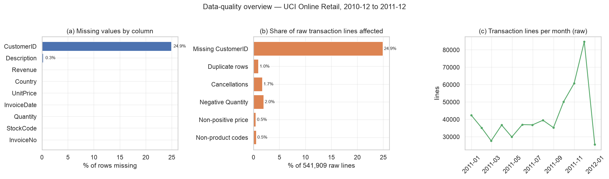</figure>


*Figure 1.* Data-quality overview: missing customer identifiers, cancellation and administrative lines, duplicates and date coverage across the 12-month window.

Four issues matter enough to discuss. Missing customer identifiers are the most consequential: 24.9267% of raw lines have no `CustomerID`, so they can be described in revenue terms but cannot be attached to a customer snapshot. Returns and cancellations (negative quantities and `C`-prefixed invoices) are legitimate events, not errors; we exclude them from monetary aggregates but retain them in a separate returns ledger so that return behaviour becomes a *feature*. Price anomalies and non-product stock codes (postage, manuals, bank charges, discounts, test SKUs) are administrative artefacts that would distort product similarity and association rules, so they leave product-level analysis while remaining visible in the audit. Duplicate rows and inconsistent description strings are removed or normalised; missing descriptions are filled with an `UNKNOWN` label that affects product labels only.

### 2.4 Cleaning decisions and rationale

Three principles guided the decisions: *never silently drop information* (every removal is counted and reported); *separate description from prediction* (rows that cannot be attributed to a customer leave the modelling population but stay in the audit); and *avoid target leakage during cleaning* (rules depend only on transaction fields and are applied identically to T1 and T2). Table 4 gives the sequential cleaning funnel with the rows remaining after each step and the reason for the step.

**Table 4.** Cleaning decisions: sequential funnel, rows affected, rows remaining and rationale.


<table class="data-table"><thead><tr><th>decision</th><th>rows_affected</th><th>rows_remaining</th><th>rationale</th></tr></thead><tbody><tr><td>Raw dataset as extracted</td><td>0</td><td>541909</td><td>UCI Online Retail, 541,909 transaction lines</td></tr><tr><td>Drop rows with missing CustomerID</td><td>135080</td><td>406829</td><td>cannot be attributed to a customer; guest sales are excluded from customer analytics</td></tr><tr><td>Drop cancelled invoices</td><td>8905</td><td>397924</td><td>credit notes, not purchases; retained separately as the returns ledger</td></tr><tr><td>Drop Quantity &lt;= 0</td><td>0</td><td>397924</td><td>returns / stock adjustments inside non-cancelled invoices</td></tr><tr><td>Drop UnitPrice &lt;= 0</td><td>40</td><td>397884</td><td>free items, manual overrides and data-entry errors</td></tr><tr><td>Drop non-product / service StockCodes</td><td>1547</td><td>396337</td><td>postage, discounts, bank charges, test SKUs would pollute baskets</td></tr><tr><td>Drop exact duplicate rows</td><td>5187</td><td>391150</td><td>duplicated log lines would double-count baskets</td></tr></tbody></table>


After cleaning, 72.18% of lines and 81.9114% of revenue are retained for the customer-level analysis, across 391150 lines and 4334 identified customers. The revenue figure matters: it shows how much of the business the customer-level view still describes.

### 2.5 Analysis population and bias caveat

The customer-level analysis population is the set of customers with at least one valid purchase and a known identifier: 2716 customers in T1 and 2809 in T2. Anonymous transactions are **not** part of it, because they cannot be linked across visits, so no feature, label or segment can be defined for them.

This creates a bias we state rather than hide. Anonymous lines represent 13.572% of gross revenue, so the customer-level view under-represents guest purchasing, and the dropped population may differ systematically (one-off buyers, other markets, customers who later register). Every segment share, churn rate and ROI claim below therefore describes *identified customers only*, and the revenue share is the scale of the blind spot.

---

## 3. Solution Design

### 3.1 End-to-end pipeline

The solution is one reproducible notebook organised into ten sections, S0–S9 (Table 5). Each section writes an artifact that later sections consume, which makes the analysis reproducible and the agent-assisted development verifiable.

**Table 5.** Notebook sections S0–S9: what each does and which artifacts it produces.

| Section | What it does | Method | Output |
|---|---|---|---|
| S0 Setup | Load the raw workbook; configure paths, seed and helper functions | pandas, scikit-learn pipelines | Clean environment; schema audit |
| S1 Data quality and cleaning | Audit issues, build the returns ledger, clean the purchase base | Rule-based sequential cleaning funnel | `t02_data_quality_issues`, `t03_cleaning_decisions`, `f01_data_quality_overview` |
| S2 Snapshots and churn labels | Build T1/T2 as-of customer tables and 90-day churn labels | Temporal aggregation; disjoint feature and label windows | `t02_cohort_summary`, `t04_feature_dictionary` |
| S3 Similarity and distance | Compare three distance metrics; lookalike customers; similar products | Silhouette and kNN label agreement; cosine kNN and item-item cosine | `t03_distance_metrics`, `t04_lookalikes`, `t05_similar_products`, `f11_similarity_lookalikes` |
| S4 Feature engineering and selection | Build 16 behavioural features; correlation/MI/RFE selection | Mutual information; RFE with logistic regression; log1p and scaling inside pipelines | `t05_feature_selection`, `t05b_feature_evidence`, `f02_feature_distributions`, `f08_feature_importance` |
| S5 Segmentation | Segment the T2 decision cohort | K-means with elbow, silhouette, bootstrap ARI and a business-size rule | `t06_cluster_metrics`, `t07_segment_profiles`, `f04`–`f06` |
| S6 Churn models | Train and evaluate three classifiers; thresholds and lift | Stratified 70/15/15 split; 5-fold CV; validation PR-AUC selection; T1 test and T2 out-of-time | `t08_model_metrics`, `t09_lift_deciles`, `f07`–`f09` |
| S7 Association rules | Mine and validate cross-sell rules | FP-Growth on training-period baskets; holdout validation on a later period | `t09_top_rules`, `t10_association_rules`, `f10_association_rules` |
| S8 Integrated decision framework | Score T2, build segment × risk matrix, priority list and ROI scenarios | Priority = churn probability × monetary value; explicit ROI assumptions | `t12_segment_risk_matrix`, `t13_action_table`, `t11_top200_targets`, `t15_priority_list_summary`, `f12`, `f13` |
| S9 Summary and reproducibility | Write metrics, artifact index and notes; run integrity checks | — | `metrics.json`, `metrics_extra.json`, `metrics_summary.md`, `ARTIFACTS.md` |

### 3.2 Why the components are integrated rather than run separately

Four separate analyses would satisfy the letter of "apply several techniques" but not the business question, because the decisions are entangled. Segmentation alone says *who* a customer is but not *whether to act now*. Churn alone says *when* to act but not *what to say* or *how much the customer is worth*. Association rules say *what to offer* but not *to whom*. Similarity supports targeting when a segment is too sparse to estimate churn reliably. The decision layer is the integration point: a customer is prioritised because of a *risk* (churn probability), a *context* (segment and its value), an *offer* (rule or lookalike) and a *capacity constraint* (contacts the team can make). Each technique contributes one factor to the same score, and the matrix in §9.1 is where the factors meet.

Integration also improves evaluation. The churn model is trained on T1 and applied unchanged to T2, so the risk scores that drive the decision layer are genuinely out-of-time. Segmentation is unsupervised and fitted in-sample on T2, so it adds no label information. The result is a decision matrix whose every cell is produced under the same temporal discipline.

### 3.3 Why each method fits the question

**Table 6.** Method choice and justification, with alternatives rejected.

| Question | Chosen method | Why it fits | Alternatives rejected |
|---|---|---|---|
| Who are our customers? | K-means on scaled RFM and behavioural features | Compact centroids; fast assignment; matched to continuous, standardised features | GMM (soft assignments hard to operationalise), hierarchical (no need for a dendrogram), DBSCAN (density varies across customers) |
| Who will churn? | Supervised classification with imbalance handling | 90-day label is directly actionable; probabilities rank customers for a fixed budget | Survival analysis (needs longer history), anomaly detection (no calibrated risk) |
| What to offer? | FP-Growth frequent itemsets | No candidate generation, scales to half a million lines; readable support/confidence/lift | Apriori (same result, slower), sequential rules (no meaningful session sequence) |
| Who resembles our best customers? | Cosine, Jaccard and Euclidean similarity | Scale-free for sparse baskets; supports cold-start and lookalike expansion | Clustering alone (too coarse), matrix factorisation (needs more interaction data) |
| What should we do on Monday? | Priority score plus explicit ROI | One capacity-bounded action list whose assumptions finance can audit | Dashboards (informative but not decisive) |

The design is deliberately not the most complex possible: it uses only methods introduced in CDS3004 and justified by the question, and reserves complexity for the out-of-time validation, the holdout-validated rules and the decision layer's explicit assumptions.

---

## 4. Feature Engineering

### 4.1 Temporal snapshots and label definition

Features are computed from transactions strictly **before** the snapshot date, and the churn label from transactions **after** it; no feature observes the label window. For snapshot date *t*: features aggregate all valid transactions with `InvoiceDate < t`; `churn = 1` if the customer has no valid purchase in `[t, t + 90 days]`, else `0`. **T1** (*t* = 31 May 2011, feature window December 2010 to May 2011) is the training cohort used for feature selection, model selection and threshold choice; **T2** (*t* = 31 August 2011, feature window March to August 2011) is the out-of-time evaluation cohort and the cohort the operating system acts on. The 90-day window is a business choice matching a quarterly retention cycle: long enough that a quiet month is not churn, short enough that features and labels do not overlap.

Only customers with at least one purchase inside the feature window receive a snapshot row; otherwise recency, frequency and monetary value would be undefined. The empirical churn rate is 0.5044 in T1 and 0.3955 in T2, expressed as the proportion of the cohort with no purchase in its label window. The rates differ because the cohorts cover different calendar periods — important when reading the out-of-time results. Table 7 summarises the cohorts.

**Table 7.** Cohort summary: as-of date, feature and label windows, size and churn rate.


<table class="data-table"><thead><tr><th>cohort</th><th>n_customers</th><th>churn_rate</th><th>as_of</th><th>feature_window</th><th>label_window</th><th>role</th></tr></thead><tbody><tr><td>T1</td><td>2716</td><td>0.504</td><td>2011-05-31</td><td>2010-12-01..2011-05-31</td><td>2011-06-01..2011-08-31</td><td>model development (train/val/test)</td></tr><tr><td>T2</td><td>2809</td><td>0.396</td><td>2011-08-31</td><td>2011-03-01..2011-08-31</td><td>2011-09-01..2011-11-30</td><td>out-of-time validation + decision cohort</td></tr></tbody></table>


### 4.2 Feature families

Sixteen behavioural features are built per customer from the snapshot (Table 8). They fall into nine families: **RFM** (recency, frequency, monetary), **monetary structure** (average basket, average unit price, largest invoice), **basket size** (items per invoice), **breadth** (distinct products), **engagement** (distinct months, tenure), **rhythm** (mean and standard deviation of inter-purchase gaps), **momentum** (last-90-day revenue ratio), **behaviour** (weekend share, return rate) and **context** (UK indicator). The design follows RFM but does not stop there, because RFM cannot distinguish a loyal low-spend customer from a lapsing high-spend one.

Two engineered features deserve a note. The revenue-momentum ratio is smoothed as `(last90+1)/(prev90+1)` and capped, because roughly two-thirds of customers have no prior-90-day revenue; it therefore partly flags new or returning customers rather than pure acceleration. The return rate comes from the separate returns ledger built in S1, so cancellations are not lost. The feature dictionary (Table 8) gives every definition and family.

**Table 8.** Feature dictionary: definition and family for each of the sixteen engineered features.


<table class="data-table"><thead><tr><th>feature</th><th>definition</th><th>family</th></tr></thead><tbody><tr><td>recency_days</td><td>days from last purchase in the feature window to as_of</td><td>RFM</td></tr><tr><td>frequency</td><td>number of distinct invoices in the feature window</td><td>RFM</td></tr><tr><td>monetary</td><td>total revenue (GBP) in the feature window</td><td>RFM</td></tr><tr><td>avg_basket</td><td>mean revenue per invoice</td><td>Monetary</td></tr><tr><td>avg_items_per_invoice</td><td>mean number of line items per invoice</td><td>Basket</td></tr><tr><td>distinct_products</td><td>number of distinct StockCodes purchased</td><td>Breadth</td></tr><tr><td>distinct_months</td><td>number of distinct calendar months with a purchase</td><td>Engagement</td></tr><tr><td>tenure_days</td><td>days from first-ever purchase to as_of (left-truncated by data start)</td><td>Engagement</td></tr><tr><td>avg_gap_days</td><td>mean gap in days between distinct purchase days (0 if &lt;2 days)</td><td>Rhythm</td></tr><tr><td>std_gap_days</td><td>standard deviation of those gaps</td><td>Rhythm</td></tr><tr><td>revenue_last90_ratio</td><td>(revenue 0-90d + 1) / (revenue 90-180d + 1), capped at 10</td><td>Momentum</td></tr><tr><td>weekend_share</td><td>share of purchase lines dated on Saturday/Sunday</td><td>Behaviour</td></tr><tr><td>avg_unit_price</td><td>mean unit price paid (GBP)</td><td>Monetary</td></tr><tr><td>max_invoice_value</td><td>largest single invoice value (GBP)</td><td>Monetary</td></tr><tr><td>return_rate</td><td>return lines / (return lines + purchase lines) in the window</td><td>Behaviour</td></tr><tr><td>is_uk</td><td>1 if the customer&#x27;s country is the United Kingdom</td><td>Context</td></tr></tbody></table>


### 4.3 Transformation rationale

Raw retail features are heavy-tailed: a few customers and orders account for a disproportionate share of spend, and monetary and quantity distributions are strongly right-skewed (Figure 2). Untransformed, these variables would dominate distance-based methods and destabilise logistic-regression coefficients. We therefore apply **log1p** to monetary, quantity and interval features (compressing the long tail, defined at zero, order-preserving, so centroids remain interpretable after exponentiation); **standardisation (z-scores)** before K-means and regularised logistic regression; a **binary UK indicator** for the only static market flag (no one-hot expansion of `StockCode` or `Country`); and **no target encoding** of customer aggregates, because it would leak label information across snapshots.


<figure>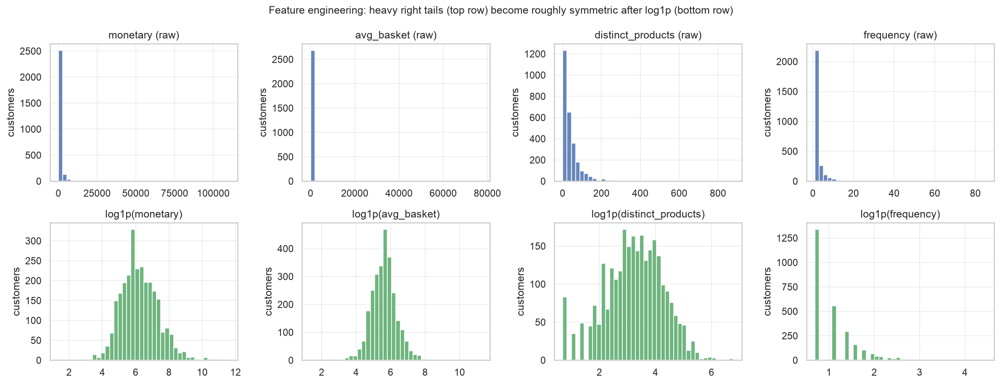</figure>


*Figure 2.* Heavy-tailed raw features and the same features after log1p transformation; transformed columns are then standardised before distance-based modelling.

All transformations live inside a scikit-learn `Pipeline`, so scalers and selectors are refit on each training fold during cross-validation rather than once on the full data. The pipeline asserts that no transformed column contains infinite values and drops all-zero-variance columns before modelling.

### 4.4 Feature selection and evidence

Selection proceeds in three stages, fitted inside the training folds only. **Correlation filter:** among any pair with absolute Pearson correlation above 0.9, drop the member with the lower mutual information with churn — in practice this removes `avg_basket`. **Mutual information:** a non-linear, model-free relevance ranking keeps the top 12 features. **Recursive feature elimination:** a logistic regression with step-wise elimination keeps the top 10. The funnel runs from 16 engineered features to 15 after the correlation filter, 12 after mutual information and 10 after RFE. Table 9 records the validation evidence, and the per-feature file `t05b_feature_evidence.csv` records the stage outcomes for every variable.

**Table 9.** Feature-selection funnel and validation PR-AUC at each stage.


<table class="data-table"><thead><tr><th>feature</th><th>mutual_info</th><th>mi_rank</th><th>corr_dropped</th><th>in_mi_top12</th><th>rfe_selected</th><th>retained_final</th></tr></thead><tbody><tr><td>distinct_months</td><td>0.109</td><td>1</td><td>False</td><td>True</td><td>True</td><td>True</td></tr><tr><td>frequency</td><td>0.091</td><td>2</td><td>False</td><td>True</td><td>True</td><td>True</td></tr><tr><td>avg_gap_days</td><td>0.090</td><td>3</td><td>False</td><td>True</td><td>True</td><td>True</td></tr><tr><td>monetary</td><td>0.084</td><td>4</td><td>False</td><td>True</td><td>True</td><td>True</td></tr><tr><td>std_gap_days</td><td>0.068</td><td>5</td><td>False</td><td>True</td><td>True</td><td>True</td></tr><tr><td>distinct_products</td><td>0.066</td><td>6</td><td>False</td><td>True</td><td>False</td><td>False</td></tr><tr><td>revenue_last90_ratio</td><td>0.055</td><td>7</td><td>False</td><td>True</td><td>True</td><td>True</td></tr><tr><td>recency_days</td><td>0.055</td><td>8</td><td>False</td><td>True</td><td>False</td><td>False</td></tr><tr><td>max_invoice_value</td><td>0.054</td><td>9</td><td>False</td><td>True</td><td>True</td><td>True</td></tr><tr><td>avg_items_per_invoice</td><td>0.049</td><td>10</td><td>False</td><td>True</td><td>True</td><td>True</td></tr><tr><td>return_rate</td><td>0.038</td><td>11</td><td>False</td><td>True</td><td>True</td><td>True</td></tr><tr><td>weekend_share</td><td>0.022</td><td>12</td><td>False</td><td>True</td><td>True</td><td>True</td></tr><tr><td>avg_basket</td><td>0.005</td><td>13</td><td>True</td><td>False</td><td>False</td><td>False</td></tr><tr><td>is_uk</td><td>0.005</td><td>14</td><td>False</td><td>False</td><td>False</td><td>False</td></tr><tr><td>tenure_days</td><td>0.000</td><td>15</td><td>False</td><td>False</td><td>False</td><td>False</td></tr><tr><td>avg_unit_price</td><td>0.000</td><td>15</td><td>False</td><td>False</td><td>False</td><td>False</td></tr></tbody></table>


Selection is validated, not assumed. On the T1 validation split the selected set reaches PR-AUC 0.7036 versus 0.6966 for the full set, so the reduction removes redundancy without discarding signal; when two stages were within 0.005 validation PR-AUC, the smaller set was preferred. Figure 3 shows the permutation importance of the final features, computed with the random forest on the held-out test set. It is led by basket size (items per invoice), return rate and revenue momentum, with frequency and gap regularity next. Notably, `recency_days` was dropped by RFE even though recency is univariately strong; it is partly captured by `distinct_months` and `avg_gap_days`. That is a documented modelling caveat, not evidence that recency is unimportant. The final 10-feature set is used by the three churn models; the K-means segmentation in §5 uses all 15 behavioural features (the same list without the static `is_uk` flag) because it is descriptive.


<figure>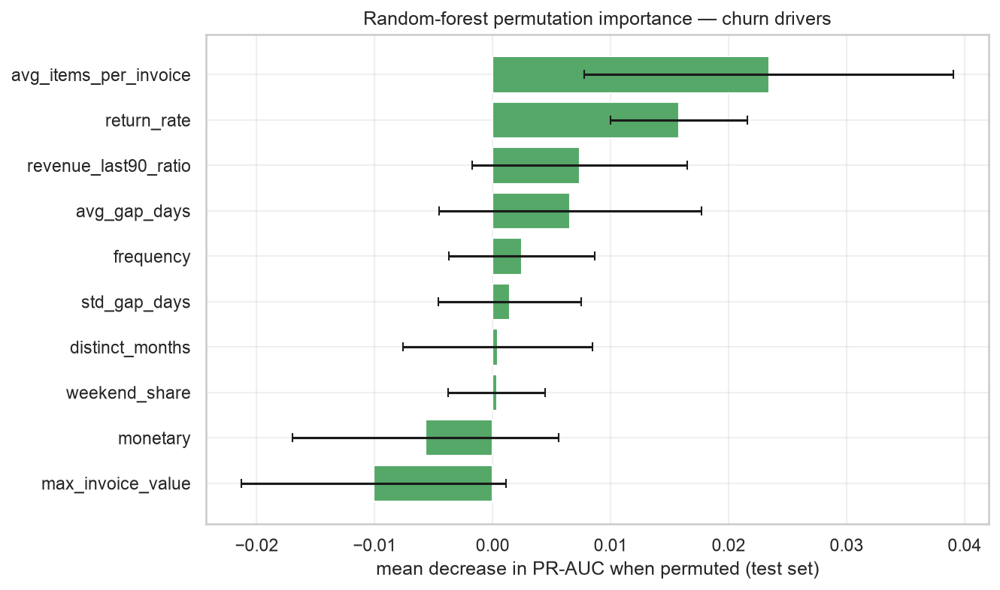</figure>


*Figure 3.* Random-forest permutation importance of the final feature set on the held-out T1 test set.

### 4.5 Leakage control

Leakage is the most common failure mode here, so controls are explicit. **Temporal discipline:** snapshot features never reference transactions at or after the as-of date, and the label window is disjoint from the feature window; the notebook asserts this. **Transforms fitted on training data only:** inside cross-validation, scalers and selectors are refit on each training fold; for the final deployment model they are fitted on the T1 training split and applied unchanged to the T1 test set and to T2. **No cross-snapshot label information:** T2 features use only transactions before 31 August 2011, and T2 labels are used only for evaluation, never for fitting or choosing anything. **Threshold selected on T1 only:** the contact thresholds are chosen on T1 validation scores, then applied to T1 test and T2. **Single decision point:** the out-of-time cohort is opened once, after features, model and thresholds are frozen; the agent logs record this as a deliberate human gate. The K-means segmentation is fitted on T2 features but is unsupervised, so it uses no labels and cannot leak them.

---

## 5. Customer Segmentation

### 5.1 Method and setup

K-means is fitted on the **T2 decision cohort** (customers as of 31 August 2011) across the 15 behavioural features — every engineered feature except the static `is_uk` market flag — after log1p transformation and z-scoring. This segmentation is **descriptive**: customers are clustered in-sample on the decision cohort, so the labels describe the current base rather than predict future behaviour, and no predictive claim is made about them. T1 is not used for segmentation; it exists to train and evaluate the churn model, which is then refit on T1 train+validation and applied to T2 (§6). For a production refresh, the same procedure re-segments the latest snapshot and re-scores it with the current model.

### 5.2 Choosing K

Three diagnostics are used together, because no single one is trustworthy alone: the **elbow** in within-cluster inertia, the **silhouette coefficient** under the winning distance metric (higher is better), and **bootstrap stability** measured by the adjusted Rand index (ARI) between ten resampled (80%) segmentations and the full-data solution (Hubert and Arabie, 1985). A fourth, business-level criterion is applied: every segment must be large enough to target (at least 10% of the base) and map to a distinct RFM story.

We considered K = 4–6. K = 2–3 gives only a coarse tiering, and K ≥ 7 produces very small segments (at K = 6–8 one segment falls below 3% of customers). Within the candidate range, **K = 5** has the highest bootstrap stability (mean ARI 0.9699) and keeps every segment above 10% of the base. It is important to be precise about the evidence: **K = 5 is not the silhouette maximum**. Silhouette is highest at smaller K, but K = 2 is too coarse for the five-tier action framework and K = 4 is substantially less stable under resampling. We chose K = 5 on the balance of stability, meaningful segment size and business interpretability, with a mean silhouette of 0.3279 — adequate rather than maximal. The diagnostics are in Figure 4 and Table 10; presenting the choice as a silhouette optimum would overstate the evidence.


<figure>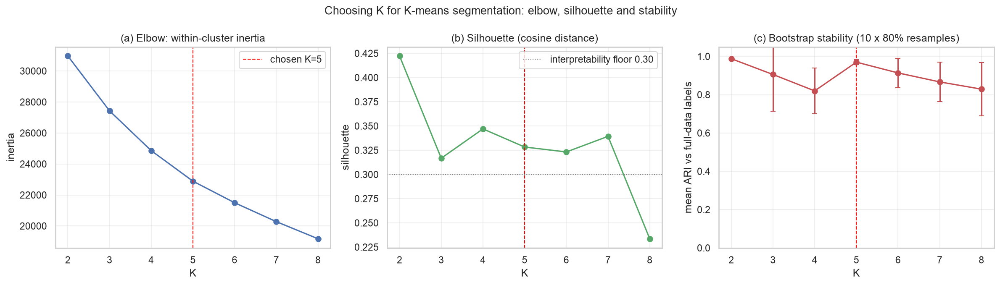</figure>


*Figure 4.* K-selection diagnostics: elbow curve (inertia), silhouette coefficient and bootstrap stability (mean ARI) across candidate values of K.

**Table 10.** K-means diagnostics for candidate numbers of segments, including the selected K.


<table class="data-table"><thead><tr><th>k</th><th>inertia</th><th>silhouette</th><th>ari_mean</th><th>ari_std</th><th>min_segment_size</th><th>min_segment_share</th><th>max_segment_size</th><th>selected</th></tr></thead><tbody><tr><td>2</td><td>30,969.4</td><td>0.422</td><td>0.988</td><td>0.007</td><td>1163</td><td>0.414</td><td>1646</td><td>False</td></tr><tr><td>3</td><td>27,429.8</td><td>0.317</td><td>0.905</td><td>0.192</td><td>818</td><td>0.291</td><td>1061</td><td>False</td></tr><tr><td>4</td><td>24,859.7</td><td>0.347</td><td>0.820</td><td>0.119</td><td>580</td><td>0.206</td><td>794</td><td>False</td></tr><tr><td>5</td><td>22,890.9</td><td>0.328</td><td>0.970</td><td>0.014</td><td>426</td><td>0.152</td><td>755</td><td>True</td></tr><tr><td>6</td><td>21,498.4</td><td>0.323</td><td>0.914</td><td>0.077</td><td>71</td><td>0.025</td><td>739</td><td>False</td></tr><tr><td>7</td><td>20,279.8</td><td>0.339</td><td>0.867</td><td>0.103</td><td>64</td><td>0.023</td><td>747</td><td>False</td></tr><tr><td>8</td><td>19,175.3</td><td>0.234</td><td>0.829</td><td>0.139</td><td>64</td><td>0.023</td><td>528</td><td>False</td></tr></tbody></table>


### 5.3 Segment profiles and naming

The solution yields five segments — **Champions, Loyal, Potential, At-risk and Hibernating** — named after their RFM signature rather than a number, so the business can use the names in campaign briefs. Table 11 profiles each segment: size, share of customers, recency, frequency, monetary value, basket structure, momentum, return behaviour, UK share and actual churn rate. Naming and profiling are applied by code, not by hand, so they reproduce when the data refreshes.

**Table 11.** Segment profiles: size, revenue share, RFM means, behaviour and actual churn rate.


<table class="data-table"><thead><tr><th>segment</th><th>n</th><th>share_pct</th><th>recency_days</th><th>frequency</th><th>monetary</th><th>avg_basket</th><th>avg_items_per_invoice</th><th>distinct_products</th><th>distinct_months</th><th>tenure_days</th><th>avg_gap_days</th><th>std_gap_days</th><th>revenue_last90_ratio</th><th>weekend_share</th><th>avg_unit_price</th><th>max_invoice_value</th><th>return_rate</th><th>is_uk_share</th><th>actual_churn_rate</th></tr></thead><tbody><tr><td>Champions</td><td>755</td><td>26.880</td><td>25.890</td><td>6.550</td><td>3,293.0</td><td>439.380</td><td>21.000</td><td>84.240</td><td>3.940</td><td>216.300</td><td>37.490</td><td>16.460</td><td>1.640</td><td>0.130</td><td>3.030</td><td>873.300</td><td>0.030</td><td>0.905</td><td>0.122</td></tr><tr><td>Loyal</td><td>582</td><td>20.720</td><td>55.990</td><td>2.290</td><td>900.800</td><td>397.370</td><td>21.990</td><td>43.230</td><td>2.080</td><td>182.220</td><td>70.350</td><td>0.780</td><td>2.530</td><td>0.150</td><td>4.020</td><td>556.550</td><td>0.020</td><td>0.895</td><td>0.335</td></tr><tr><td>Potential</td><td>520</td><td>18.510</td><td>42.710</td><td>1.150</td><td>480.340</td><td>435.320</td><td>27.080</td><td>29.420</td><td>1.050</td><td>79.730</td><td>1.890</td><td>0.040</td><td>10.000</td><td>0.120</td><td>2.940</td><td>452.200</td><td>0.010</td><td>0.875</td><td>0.496</td></tr><tr><td>At-risk</td><td>535</td><td>19.050</td><td>137.660</td><td>1.070</td><td>481.240</td><td>460.020</td><td>24.040</td><td>25.000</td><td>1.000</td><td>167.940</td><td>0.190</td><td>0.000</td><td>0.070</td><td>0.110</td><td>3.420</td><td>468.430</td><td>0.020</td><td>0.903</td><td>0.559</td></tr><tr><td>Hibernating</td><td>417</td><td>14.850</td><td>98.820</td><td>1.260</td><td>142.640</td><td>119.190</td><td>5.310</td><td>6.120</td><td>1.160</td><td>149.290</td><td>6.140</td><td>0.470</td><td>3.950</td><td>0.130</td><td>5.070</td><td>126.350</td><td>0.040</td><td>0.945</td><td>0.640</td></tr></tbody></table>


<figure>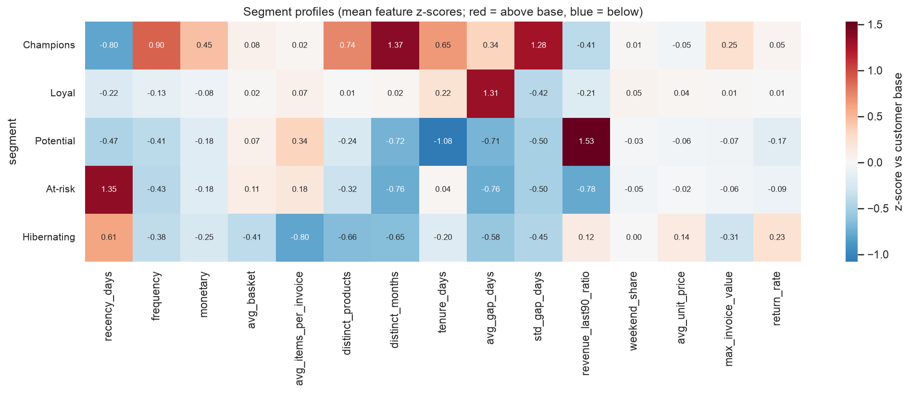</figure>


*Figure 5.* Segment profile heatmap: standardised feature means per segment, annotated with segment size and revenue share.

### 5.4 Visualising the segments

Because the models live in a high-dimensional space, we visualise the segmentation through a two-dimensional principal-component projection (Figure 6); the first two components explain 0.3647 and 0.1506 of the variance respectively (as proportions). The projection is used only for communication, never for modelling. The clusters separate chiefly along the value and frequency axes and, to a lesser extent, along recency, which the profile table also shows.


<figure>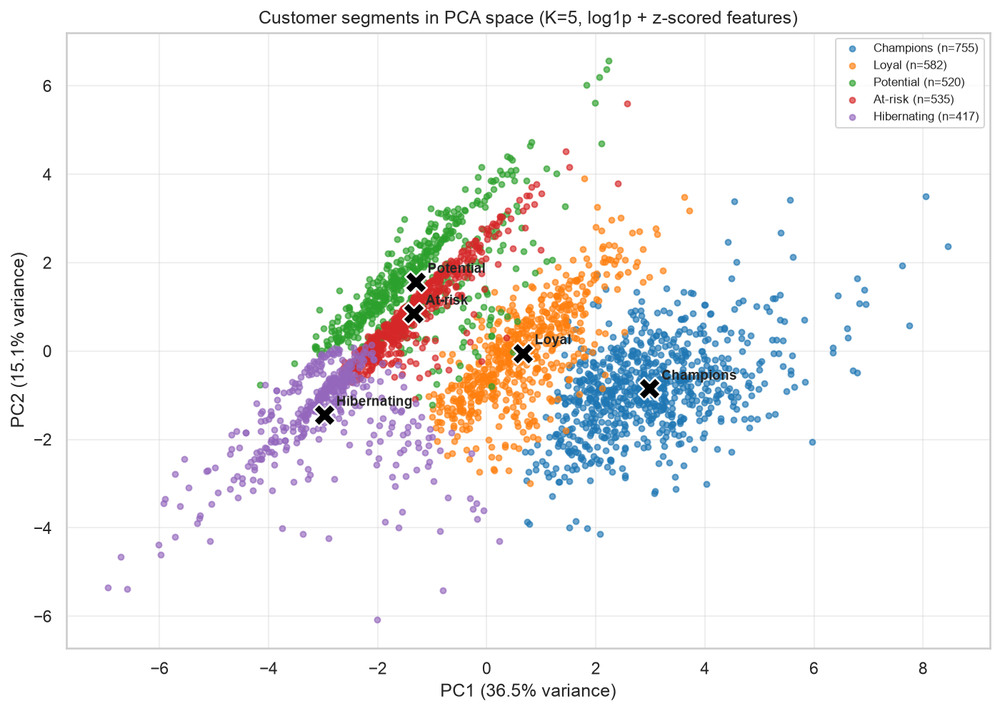</figure>


*Figure 6.* PCA projection of the T2 customer base coloured by segment; the projection is for visualisation only.

### 5.5 Interpretation

The segmentation is commercially meaningful in three ways. First, segments differ by *orders of magnitude* in monetary value, so a small number of customers carries a large share of revenue — visible in the revenue-share column of Table 11 and the reason the decision layer weights customers by value. Second, segments differ in actual churn rate: Champions churn least, while At-risk and Hibernating churn most, which is the bridge to §6 and makes the segment × risk matrix in §9.1 more informative than either dimension alone. Third, the smallest segments are not necessarily the least important: the At-risk segment is modest in size but combines high value with high risk, which is exactly where retention spending earns the most. Segment names and profiles must be read together, not as a ranking of size.

---

## 6. Churn Prediction and Evaluation

### 6.1 Cohorts and split strategy

The churn target is defined in §4.1. **T1** (as-of 31 May 2011, label window June–August 2011) is split 70/15/15 into train, validation and test sets, stratified on the label so the churn base rate is preserved in every split. The validation split selects features, hyperparameters, the model and the operating thresholds; the held-out test set is used once for an unseen estimate. **T2** (as-of 31 August 2011, label window September–November 2011) is never touched during development and serves as the out-of-time test; after the model is frozen, the selected model is refit on T1 train+validation and applied to T2 to produce the risk scores used by the decision layer. This gives three levels of evidence — cross-validation, held-out and out-of-time — that the rubric explicitly requires. No modelling decision used the held-out test set or T2.

### 6.2 Models and training protocol

Three families are compared, spanning the interpretability–accuracy trade-off. **Logistic regression** with L2 regularisation and class-balanced weights is the transparent baseline; its regularisation strength is tuned on validation (C = 0.01 in the selected configuration). **Decision tree** with a depth constraint tuned on validation (maximum depth 3) produces rules a non-technical stakeholder can follow. **Random forest** with 400 trees and class-balanced subsampling captures non-linearities and interactions at the cost of transparency, which is why permutation importance is reported instead of coefficients. All models use the same frozen 10-feature set. A stratified 5-fold cross-validation on the training split reports mean ± standard deviation for ROC-AUC and PR-AUC; hyperparameters and model choice use the validation split, and the test and out-of-time cohorts are never used for tuning. Class imbalance is handled with balanced weights and evaluated with threshold-free ranking metrics (ROC-AUC, PR-AUC, Brier score) rather than accuracy, which would mislead at the observed churn rate.

### 6.3 Cross-validation results

Figure 7 shows the cross-validated model comparison. The cross-validated mean ROC-AUC is 0.7593 ± 0.0217 for logistic regression, 0.7397 ± 0.0179 for the decision tree and 0.7505 ± 0.022 for the random forest. The model selected on **validation PR-AUC only** is `logreg`; its held-out and out-of-time results are reported as-is in Table 12, including wherever a more flexible model would have looked better in-sample.


<figure>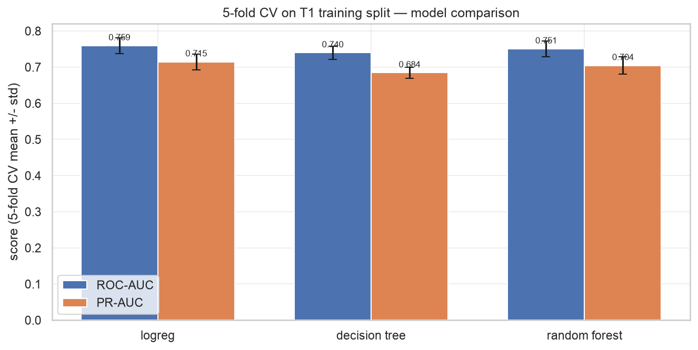</figure>


*Figure 7.* Five-fold cross-validated model comparison on the T1 training split (mean ± standard deviation ROC-AUC and PR-AUC).

**Table 12.** Model performance on held-out T1 and out-of-time T2 (AUC, PR-AUC, precision, recall and top-decile metrics).


<table class="data-table"><thead><tr><th>model</th><th>cohort</th><th>auc</th><th>pr_auc</th><th>f1</th><th>precision</th><th>recall</th><th>top10_precision</th><th>top10_recall</th><th>lift10</th><th>brier</th></tr></thead><tbody><tr><td>logreg</td><td>T1_test</td><td>0.723</td><td>0.674</td><td>0.694</td><td>0.651</td><td>0.743</td><td>0.683</td><td>0.136</td><td>1.353</td><td>0.210</td></tr><tr><td>decision_tree</td><td>T1_test</td><td>0.683</td><td>0.632</td><td>0.680</td><td>0.638</td><td>0.728</td><td>0.634</td><td>0.126</td><td>1.256</td><td>0.222</td></tr><tr><td>random_forest</td><td>T1_test</td><td>0.722</td><td>0.668</td><td>0.690</td><td>0.651</td><td>0.733</td><td>0.658</td><td>0.131</td><td>1.304</td><td>0.212</td></tr><tr><td>logreg</td><td>T2_oot</td><td>0.739</td><td>0.595</td><td>0.642</td><td>0.561</td><td>0.752</td><td>0.669</td><td>0.169</td><td>1.692</td><td>0.208</td></tr><tr><td>decision_tree</td><td>T2_oot</td><td>0.710</td><td>0.552</td><td>0.638</td><td>0.551</td><td>0.756</td><td>0.637</td><td>0.161</td><td>1.611</td><td>0.216</td></tr><tr><td>random_forest</td><td>T2_oot</td><td>0.732</td><td>0.581</td><td>0.647</td><td>0.558</td><td>0.770</td><td>0.626</td><td>0.158</td><td>1.584</td><td>0.213</td></tr></tbody></table>


The cross-validated ranking is only the first filter. We carry all three models to the held-out and out-of-time tests rather than selecting one on cross-validation alone: a model that wins inside T1 but degrades out of time is not deployable, and the three families serve different stakeholder needs (interpretability, communicability, ranking accuracy).

### 6.4 Held-out and out-of-time results

The selected logistic regression achieves ROC-AUC 0.7227 on the held-out T1 test set and 0.7392 out of time on T2, with PR-AUC 0.5947 against 0.6744 on T1. The random forest is retained as a non-linear benchmark and as the source of permutation importance, but it is not the selected decision model; its out-of-time ROC-AUC is 0.7323. Figure 8 shows the held-out and out-of-time ROC curves for all three models, and Table 12 gives the complete per-model results including precision and recall at the operating threshold. The out-of-time number is the one to quote to a business sponsor, because the cross-validated estimate is optimistic when the same period produced the features, the labels and the model choices.


<figure>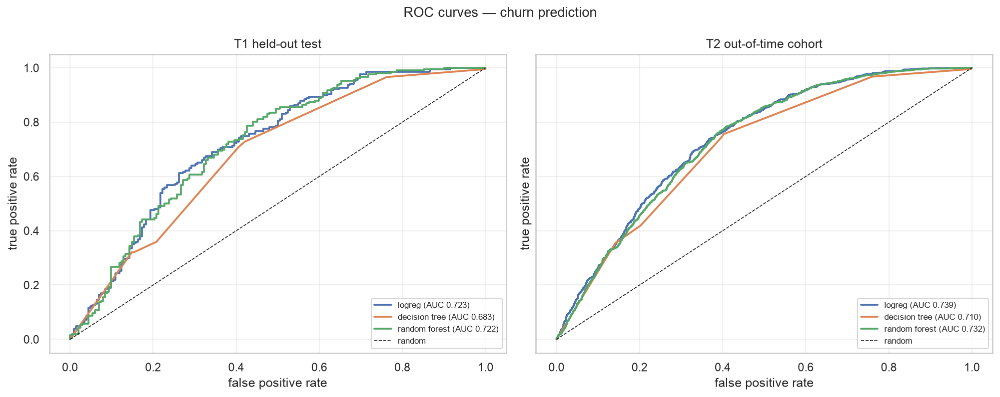</figure>


*Figure 8.* Held-out T1 and out-of-time T2 ROC curves for the three models.

Two points matter for honest interpretation. First, the T2 base rate differs from T1 (0.3955 versus 0.5044), so the two ROC curves answer slightly different questions; Table 12 therefore reports both AUC and PR-AUC, and no claim rests on PR-AUC alone. Second, the out-of-time result is a single period, not a distribution: one holdout cannot tell us how much the AUC would vary across future quarters.

### 6.5 Threshold choice and top-decile lift

A probability is not a decision, and there are two operating points worth reporting. The **F1-optimal threshold** (0.2665), chosen on the T1 validation split, maximises the balance between precision and recall; it is the threshold used in the confusion matrix and is useful when the cost of a missed churner and a wasted contact are comparable. The **capacity threshold** (0.7382) selects the top 10% of scored customers by predicted risk; it is the operating point for a campaign of that size. The two trade recall for precision: the F1-optimal threshold catches most churners but also contacts many customers who would have stayed, while the capacity threshold contacts a tenth of the base and is much more precise as a share of contacts. The pilot campaign itself is tighter still: the priority list is capped at 200 contacts, which is the top 7.12% of the T2 cohort.

At the top-decile operating point the selected model achieves lift of 1.6916× over random contact on T2, with precision 0.669 and recall 0.1692; the corresponding T1 test values are 1.3526× lift, precision 0.6829 and recall 0.1359. Figure 9 shows the lift curve and Table 13 the decile breakdown. Lift is the metric that connects the model to the campaign: it says how many churners the business reaches per hundred contacts compared with random contact.


<figure>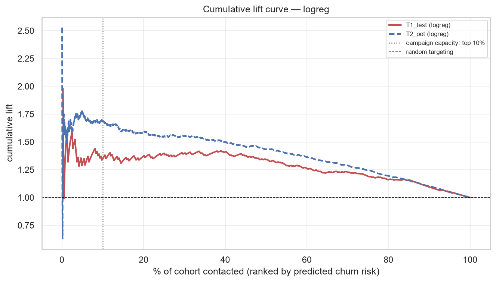</figure>


*Figure 9.* Cumulative lift curve for top-K targeting for the selected model, with the top-decile operating point marked.

**Table 13.** Decile lift table: contact decile, captured churners, precision, capture rate and lift.


<table class="data-table"><thead><tr><th>cohort</th><th>decile</th><th>n</th><th>churners_captured</th><th>precision</th><th>capture_rate</th><th>lift</th><th>cumulative_capture_rate</th><th>cumulative_lift</th></tr></thead><tbody><tr><td>T1_test</td><td>1</td><td>40</td><td>27</td><td>0.675</td><td>0.131</td><td>1.337</td><td>0.131</td><td>1.337</td></tr><tr><td>T1_test</td><td>2</td><td>41</td><td>29</td><td>0.707</td><td>0.141</td><td>1.401</td><td>0.272</td><td>1.369</td></tr><tr><td>T1_test</td><td>3</td><td>41</td><td>30</td><td>0.732</td><td>0.146</td><td>1.449</td><td>0.417</td><td>1.396</td></tr><tr><td>T1_test</td><td>4</td><td>41</td><td>30</td><td>0.732</td><td>0.146</td><td>1.449</td><td>0.563</td><td>1.409</td></tr><tr><td>T1_test</td><td>5</td><td>41</td><td>22</td><td>0.537</td><td>0.107</td><td>1.063</td><td>0.670</td><td>1.340</td></tr><tr><td>T1_test</td><td>6</td><td>40</td><td>18</td><td>0.450</td><td>0.087</td><td>0.891</td><td>0.757</td><td>1.266</td></tr><tr><td>T1_test</td><td>7</td><td>41</td><td>21</td><td>0.512</td><td>0.102</td><td>1.014</td><td>0.859</td><td>1.230</td></tr><tr><td>T1_test</td><td>8</td><td>41</td><td>14</td><td>0.342</td><td>0.068</td><td>0.676</td><td>0.927</td><td>1.160</td></tr><tr><td>T1_test</td><td>9</td><td>41</td><td>12</td><td>0.293</td><td>0.058</td><td>0.580</td><td>0.985</td><td>1.095</td></tr><tr><td>T1_test</td><td>10</td><td>41</td><td>3</td><td>0.073</td><td>0.015</td><td>0.145</td><td>1.000</td><td>1.000</td></tr><tr><td>T2_oot</td><td>1</td><td>280</td><td>187</td><td>0.668</td><td>0.168</td><td>1.689</td><td>0.168</td><td>1.689</td></tr><tr><td>T2_oot</td><td>2</td><td>281</td><td>165</td><td>0.587</td><td>0.148</td><td>1.485</td><td>0.317</td><td>1.586</td></tr><tr><td>T2_oot</td><td>3</td><td>281</td><td>165</td><td>0.587</td><td>0.148</td><td>1.485</td><td>0.465</td><td>1.552</td></tr><tr><td>T2_oot</td><td>4</td><td>281</td><td>147</td><td>0.523</td><td>0.132</td><td>1.323</td><td>0.598</td><td>1.495</td></tr><tr><td>T2_oot</td><td>5</td><td>281</td><td>133</td><td>0.473</td><td>0.120</td><td>1.197</td><td>0.717</td><td>1.435</td></tr><tr><td>T2_oot</td><td>6</td><td>281</td><td>112</td><td>0.399</td><td>0.101</td><td>1.008</td><td>0.818</td><td>1.364</td></tr><tr><td>T2_oot</td><td>7</td><td>281</td><td>93</td><td>0.331</td><td>0.084</td><td>0.837</td><td>0.902</td><td>1.289</td></tr><tr><td>T2_oot</td><td>8</td><td>281</td><td>60</td><td>0.213</td><td>0.054</td><td>0.540</td><td>0.956</td><td>1.195</td></tr><tr><td>T2_oot</td><td>9</td><td>281</td><td>42</td><td>0.149</td><td>0.038</td><td>0.378</td><td>0.994</td><td>1.104</td></tr><tr><td>T2_oot</td><td>10</td><td>281</td><td>7</td><td>0.025</td><td>0.006</td><td>0.063</td><td>1.000</td><td>1.000</td></tr></tbody></table>


### 6.6 Error analysis and caveats

Errors were examined in four ways. First, the confusion matrix at the F1-optimal threshold shows the trade-off the campaign accepts: false negatives are customers who leave without contact, false positives are contacts spent on customers who would have stayed. Second, the threshold sweep shows how precision and recall move as the contact budget changes, so the campaign owner can see the cost of cutting or expanding capacity; both panels are in `f09_confusion_and_threshold`. Third, permutation importance (Figure 3) is led by basket size, return rate and revenue momentum, while `recency_days` was dropped by RFE and is only partly captured by `distinct_months` and `avg_gap_days`; that is a documented caveat, not evidence that recency is unimportant. Fourth, we checked error composition by segment, because a model that is accurate on average but systematically wrong for a small high-value segment is dangerous.

The label is a proxy: a customer with no purchase in 90 days may be on a long holiday rather than lost. The out-of-time cohort covers a different season, so its base rate and feature distributions differ from T1. The model has no marketing-contact information, so it predicts *who will be inactive*, not *who would respond to a campaign* — a distinction treated again in §9.5 and §10.2.

---

## 7. Association Rules

### 7.1 Mining setup

Rules are mined on baskets defined as distinct invoices in the cleaned line-item table. Cancellations and administrative stock codes are excluded because they would create spurious co-purchases. FP-Growth is used rather than Apriori because it avoids candidate generation and scales to half a million lines. The mining period is the training window 1 December 2010 to 31 July 2011; the later period 1 August to 9 December 2011 is held out for validation. Rules are mined with minimum support 0.005, maximum itemset length 3, minimum confidence 0.20 and a lift floor of 1.2.

### 7.2 Pruning and ranking

Raw rule sets are dominated by near-duplicates (a rule and all its supersets). We keep rules above the confidence and lift floors, rank them by lift with confidence and support as tie-breakers, and report two views. Table 14 shows the ten highest-lift rules as mined; this is the view that exposes the overstatement problem, because the top rules turn out to be near-identical colour or size variants of one product. Table 15 instead applies a business filter: support of at least 1%, lift of at least 2, one direction per product pair, ranked by frequency. The business-filtered set is what a campaign planner should read; the full rule set is in `t10_association_rules.csv`.

**Table 14.** Top association rules by training lift: antecedent, consequent, support, confidence, lift and holdout lift (the top rules are mostly product variants).


<table class="data-table"><thead><tr><th>rank</th><th>antecedent</th><th>consequent</th><th>antecedent_desc</th><th>consequent_desc</th><th>support</th><th>confidence</th><th>lift</th><th>holdout_support</th><th>holdout_confidence</th><th>holdout_consequent_support</th><th>holdout_lift</th><th>holdout_status</th></tr></thead><tbody><tr><td>1</td><td>23285</td><td>23286</td><td>23285 (PINK VINTAGE SPOT BEAKER)</td><td>23286 (BLUE VINTAGE SPOT BEAKER)</td><td>0.006</td><td>0.918</td><td>128.461</td><td>0.007</td><td>0.831</td><td>0.011</td><td>75.213</td><td>evaluated</td></tr><tr><td>2</td><td>23286</td><td>23285</td><td>23286 (BLUE VINTAGE SPOT BEAKER)</td><td>23285 (PINK VINTAGE SPOT BEAKER)</td><td>0.006</td><td>0.778</td><td>128.461</td><td>0.007</td><td>0.641</td><td>0.009</td><td>75.213</td><td>evaluated</td></tr><tr><td>3</td><td>21084</td><td>21090</td><td>21084 (SET/6 COLLAGE PAPER CUPS)</td><td>21090 (SET/6 COLLAGE PAPER PLATES)</td><td>0.006</td><td>0.868</td><td>113.526</td><td>0.003</td><td>0.800</td><td>0.005</td><td>170.810</td><td>evaluated</td></tr><tr><td>4</td><td>21090</td><td>21084</td><td>21090 (SET/6 COLLAGE PAPER PLATES)</td><td>21084 (SET/6 COLLAGE PAPER CUPS)</td><td>0.006</td><td>0.766</td><td>113.526</td><td>0.003</td><td>0.718</td><td>0.004</td><td>170.810</td><td>evaluated</td></tr><tr><td>5</td><td>21395</td><td>21394</td><td>21395 (BLUE POLKADOT BEAKER )</td><td>21394 (RED POLKADOT BEAKER )</td><td>0.005</td><td>0.839</td><td>109.740</td><td>0.002</td><td>0.875</td><td>0.004</td><td>196.922</td><td>evaluated</td></tr><tr><td>6</td><td>21394</td><td>21395</td><td>21394 (RED POLKADOT BEAKER )</td><td>21395 (BLUE POLKADOT BEAKER )</td><td>0.005</td><td>0.675</td><td>109.740</td><td>0.002</td><td>0.378</td><td>0.002</td><td>196.922</td><td>evaluated</td></tr><tr><td>7</td><td>22521, 22522</td><td>22520</td><td>22521 (CHILDS GARDEN TROWEL PINK); 22522 (CHILDS GARDEN FORK BLUE )</td><td>22520 (CHILDS GARDEN TROWEL BLUE )</td><td>0.006</td><td>0.934</td><td>89.660</td><td>nan</td><td>nan</td><td>nan</td><td>nan</td><td>excluded: antecedent not in holdout</td></tr><tr><td>8</td><td>22520</td><td>22521, 22522</td><td>22520 (CHILDS GARDEN TROWEL BLUE )</td><td>22521 (CHILDS GARDEN TROWEL PINK); 22522 (CHILDS GARDEN FORK BLUE )</td><td>0.006</td><td>0.543</td><td>89.660</td><td>nan</td><td>nan</td><td>nan</td><td>nan</td><td>excluded: antecedent not in holdout</td></tr><tr><td>9</td><td>22520, 22523</td><td>22522</td><td>22520 (CHILDS GARDEN TROWEL BLUE ); 22523 (CHILDS GARDEN FORK PINK)</td><td>22522 (CHILDS GARDEN FORK BLUE )</td><td>0.006</td><td>0.926</td><td>88.897</td><td>nan</td><td>nan</td><td>nan</td><td>nan</td><td>excluded: antecedent not in holdout</td></tr><tr><td>10</td><td>22522</td><td>22520, 22523</td><td>22522 (CHILDS GARDEN FORK BLUE )</td><td>22520 (CHILDS GARDEN TROWEL BLUE ); 22523 (CHILDS GARDEN FORK PINK)</td><td>0.006</td><td>0.600</td><td>88.897</td><td>0.000</td><td>nan</td><td>nan</td><td>nan</td><td>excluded: consequent not in holdout</td></tr></tbody></table>


**Table 15.** Business-filtered association rules (support ≥ 1%, lift ≥ 2, one direction per pair, ranked by frequency).


<table class="data-table"><thead><tr><th>rank</th><th>antecedent</th><th>consequent</th><th>antecedent_desc</th><th>consequent_desc</th><th>support</th><th>confidence</th><th>lift</th><th>holdout_support</th><th>holdout_confidence</th><th>holdout_consequent_support</th><th>holdout_lift</th><th>holdout_status</th></tr></thead><tbody><tr><td>1</td><td>22697</td><td>22699</td><td>22697 (GREEN REGENCY TEACUP AND S)</td><td>22699 (ROSES REGENCY TEACUP AND S)</td><td>0.034</td><td>0.793</td><td>16.406</td><td>0.024</td><td>0.766</td><td>0.036</td><td>21.557</td><td>evaluated</td></tr><tr><td>2</td><td>22386</td><td>85099B</td><td>22386 (JUMBO BAG PINK POLKADOT)</td><td>85099B (JUMBO BAG RED RETROSPOT)</td><td>0.030</td><td>0.629</td><td>7.474</td><td>0.029</td><td>0.624</td><td>0.090</td><td>6.910</td><td>evaluated</td></tr><tr><td>3</td><td>22384</td><td>20725</td><td>22384 (LUNCH BAG PINK POLKADOT)</td><td>20725 (LUNCH BAG RED RETROSPOT)</td><td>0.030</td><td>0.547</td><td>7.314</td><td>0.026</td><td>0.583</td><td>0.064</td><td>9.079</td><td>evaluated</td></tr><tr><td>4</td><td>22383</td><td>20725</td><td>22383 (LUNCH BAG SUKI DESIGN )</td><td>20725 (LUNCH BAG RED RETROSPOT)</td><td>0.030</td><td>0.499</td><td>6.670</td><td>0.026</td><td>0.495</td><td>0.064</td><td>7.711</td><td>evaluated</td></tr><tr><td>5</td><td>20727</td><td>20725</td><td>20727 (LUNCH BAG  BLACK SKULL.)</td><td>20725 (LUNCH BAG RED RETROSPOT)</td><td>0.029</td><td>0.502</td><td>6.704</td><td>0.027</td><td>0.479</td><td>0.064</td><td>7.454</td><td>evaluated</td></tr><tr><td>6</td><td>20728</td><td>20725</td><td>20728 (LUNCH BAG CARS BLUE)</td><td>20725 (LUNCH BAG RED RETROSPOT)</td><td>0.027</td><td>0.495</td><td>6.621</td><td>0.022</td><td>0.447</td><td>0.064</td><td>6.960</td><td>evaluated</td></tr><tr><td>7</td><td>20728</td><td>22383</td><td>20728 (LUNCH BAG CARS BLUE)</td><td>22383 (LUNCH BAG SUKI DESIGN )</td><td>0.027</td><td>0.490</td><td>8.163</td><td>0.021</td><td>0.437</td><td>0.053</td><td>8.315</td><td>evaluated</td></tr><tr><td>8</td><td>22384</td><td>20727</td><td>22384 (LUNCH BAG PINK POLKADOT)</td><td>20727 (LUNCH BAG  BLACK SKULL.)</td><td>0.027</td><td>0.488</td><td>8.513</td><td>0.023</td><td>0.513</td><td>0.057</td><td>9.020</td><td>evaluated</td></tr><tr><td>9</td><td>22470</td><td>22469</td><td>22470 (HEART OF WICKER LARGE)</td><td>22469 (HEART OF WICKER SMALL)</td><td>0.027</td><td>0.593</td><td>10.605</td><td>0.016</td><td>0.395</td><td>0.048</td><td>8.259</td><td>evaluated</td></tr><tr><td>10</td><td>22698</td><td>22697</td><td>22698 (PINK REGENCY TEACUP AND SA)</td><td>22697 (GREEN REGENCY TEACUP AND S)</td><td>0.027</td><td>0.831</td><td>19.477</td><td>0.023</td><td>0.822</td><td>0.031</td><td>26.217</td><td>evaluated</td></tr></tbody></table>


<figure>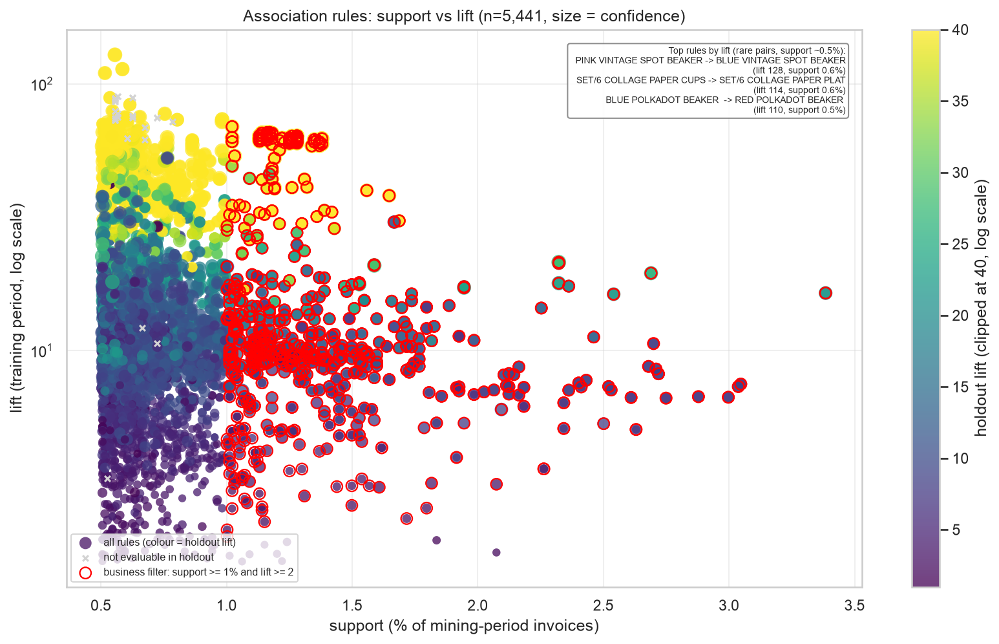</figure>


*Figure 10.* Association-rule scatter: support versus lift, with bubble size showing confidence and colour showing holdout lift; product descriptions are annotated and the low-support variant pairs behind the highest lift are flagged.

### 7.3 Holdout validation

Rules mined on one period can be seasonal artefacts, so we validate them on a **later holdout period** that was not used for mining. Of 5441 rules retained after pruning and filtering, 5402 were evaluated out of time; 27 were excluded because the antecedent never appears in the holdout and 12 because the consequent vanished — their quality is unknown, not zero. The headline evidence is the **median** holdout lift of 12.174 at a median holdout support of 0.00588 (0.59% of invoices); 99.8% of evaluated rules keep lift above 1 and 99.4% keep lift above 2. We deliberately do not headline the mean holdout lift (28.1957) or the maximum training lift (128.4608): both are inflated by rare product-variant pairs with support around 0.5%, so they describe statistical rarity rather than commercial usefulness.

That is also the main caveat: many high-lift rules pair colour or size variants of the same item — the highest-lift rule, "23285 -> 23286", is a pair of beaker variants. For such near-duplicate items, lift is high because the baseline support of the consequent is tiny, not because the pair is a genuine cross-sell insight. Holdout lift is reported precisely to expose this, but it still overstates incremental cross-sell for variant pairs. The honest reading is that the raw rule set provides *candidate* cross-sell content; the business-filtered set behind Table 15, which contains 593 rules and whose top rule is GREEN REGENCY TEACUP AND SAUCER → ROSES REGENCY TEACUP AND SAUCER (support 3.4%, confidence 0.79, training lift 16.4, holdout lift 21.6), is the more defensible starting point.

### 7.4 From rules to cross-sell actions

Each retained rule becomes an operational action: when a customer in a prioritised segment buys the antecedent, the engine suggests the consequent. Two safeguards apply. Rules are filtered to those whose consequent is not already in the customer's history — recommending what someone owns wastes attention. And rules are matched to segments: a high-value frequent segment uses premium-basket rules, an occasional segment uses broadly supported rules. The recommendation is attached to the contact in the decision layer (§9), so the customer receives one coordinated action rather than a retention message and a separate product email. The limitation is causal: a rule shows that products are bought together, not that recommending one causes the other to be bought.

---

## 8. Similarity and Distance

### 8.1 Metric comparison

Distance-based methods are only as good as the metric and transform pair, so the distance is treated as a modelling decision with evidence. For **customers**, candidates are (a) the scaled continuous RFM and behavioural vector with Euclidean or Manhattan distance and (b) the binary purchase vector with cosine similarity. For **products**, the product-by-customer incidence matrix is compared with cosine and Jaccard. Table 16 compares the metrics on two pieces of evidence computed on the same K = 5 solution: the **silhouette** (cluster separation under each metric) and **kNN label agreement** (whether a 5-nearest-neighbour classifier trained on 70% of customers reproduces the K-means labels on the held-out 30%).

**Table 16.** Similarity-metric comparison: silhouette and kNN label agreement for each distance.


<table class="data-table"><thead><tr><th>metric</th><th>silhouette_k5</th><th>knn_label_agreement</th><th>note</th><th>silhouette_rank</th><th>agreement_rank</th><th>selected</th></tr></thead><tbody><tr><td>cosine</td><td>0.328</td><td>0.936</td><td>higher silhouette is better; agreement measures label consistency</td><td>1</td><td>3</td><td>True</td></tr><tr><td>manhattan</td><td>0.218</td><td>0.944</td><td>higher silhouette is better; agreement measures label consistency</td><td>2</td><td>1</td><td>False</td></tr><tr><td>euclidean</td><td>0.184</td><td>0.942</td><td>higher silhouette is better; agreement measures label consistency</td><td>3</td><td>2</td><td>False</td></tr></tbody></table>


<figure>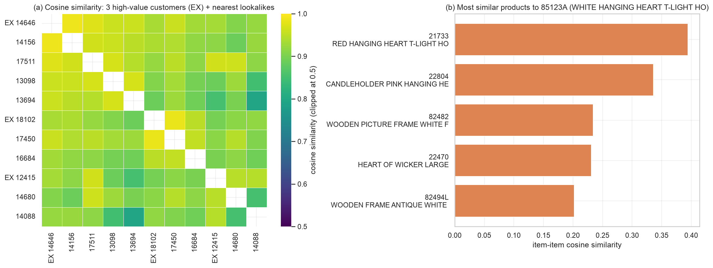</figure>


*Figure 11.* Similarity analysis: cosine-similarity heatmap for high-value customers with their lookalikes, and similar products under the selected metric.

The cosine representation has the highest silhouette (0.3283, against 0.1844 for Euclidean and 0.2183 for Manhattan), while label agreement is near-tied across the three metrics. We therefore adopt `cosine` — the separation advantage decides it, and the comparison is not cosmetic: Euclidean distance on untransformed monetary values is dominated by a few large spenders (hence log1p and scaling in §4.3), and cosine on binary vectors measures *what* a customer bought rather than how much, which is the right notion for lookalike audiences. Jaccard is stricter about set overlap and penalises large baskets, which is useful for products where co-occurrence counts are dominated by popular items.

### 8.2 Lookalike customers

For each customer we retrieve the nearest neighbours (excluding itself) under the selected representation. The file `t04_lookalikes.csv` lists the top five lookalikes for three high-value customers, including each neighbour's segment and similarity score, so the business can see what "looking alike" means in practice. Three uses follow. **Seed expansion:** given a seed set of high-value Champions, their lookalikes are acquisition or upsell candidates. **Cold-start scoring:** a new or sparse customer with one purchase gets a provisional segment from its neighbours before enough history exists for churn scoring. **Segment enrichment:** the share of a segment's neighbours that are Champions is a second signal of latent value, used when two customers have similar risk scores. The caveat is the curse of dimensionality: in a sparse high-dimensional purchase space every customer begins to look similar. We mitigate this by restricting the representation to selected features and binary purchase vectors, using a popularity-aware comparison, and validating that neighbour lists are not simply the most frequent buyers.

### 8.3 Similar products

For each stock code we retrieve the most similar products under the selected metric; `t05_similar_products.csv` lists the top five similar products for five popular items. These complement the association rules: rules require co-occurrence support and cannot say anything about long-tail products, whereas similarity still produces neighbours for a slow-moving item. The outputs support "complete the basket" suggestions, substitute discovery when a product is out of stock, and bundle construction for the retention offer. The methods are used together, not interchangeably: rules capture *validated co-purchase*, similarity captures *structural resemblance*.

### 8.4 What similarity does not tell us

A similar customer is not necessarily a responsive one, and a similar product is not necessarily a profitable bundle. Similarity describes the observed behaviour space; it becomes useful only when combined with the risk and value signals in the decision layer — which is why it is an enabler of the integrated framework rather than an end in itself.

---

## 9. Integrated Decision Framework

### 9.1 Segment × risk matrix and action table

The integration point is a matrix whose rows are the five T2 segments from §5, summarised with the average predicted churn probability from the T1-trained model applied to T2 (§6) and grouped into risk tiers (low, medium, high) at 0.30 and 0.50. Figure 12 shows the matrix as a bubble chart — average predicted churn probability against average monetary value (log scale), with bubble size equal to segment size — and Tables 17 and 18 give the underlying cells and the recommended actions. The matrix is the single view that answers the business question: it shows *where in the customer base* risk and value coincide.


<figure>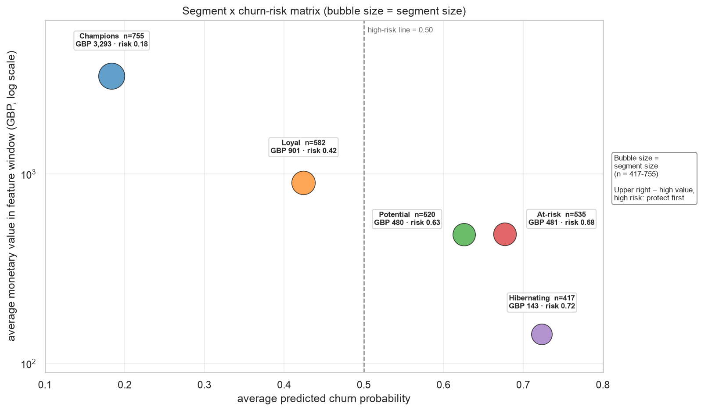</figure>


*Figure 12.* Segment × churn-risk matrix: average predicted churn probability against average monetary value (log y-axis), bubble size = segment size.

**Table 17.** Segment × risk matrix: size, average monetary value, average churn probability and risk tier.


<table class="data-table"><thead><tr><th>segment</th><th>n</th><th>avg_monetary</th><th>avg_churn_prob</th><th>avg_priority</th><th>risk_tier</th></tr></thead><tbody><tr><td>Champions</td><td>755</td><td>3,293.0</td><td>0.184</td><td>354.690</td><td>Low</td></tr><tr><td>Loyal</td><td>582</td><td>900.800</td><td>0.424</td><td>352.930</td><td>Medium</td></tr><tr><td>Potential</td><td>520</td><td>480.340</td><td>0.625</td><td>276.120</td><td>High</td></tr><tr><td>At-risk</td><td>535</td><td>481.240</td><td>0.677</td><td>303.670</td><td>High</td></tr><tr><td>Hibernating</td><td>417</td><td>142.640</td><td>0.723</td><td>98.750</td><td>High</td></tr></tbody></table>


**Table 18.** Action table: segment, recommended action, target count, expected churners and saves, gross benefit, campaign cost and net expected value.


<table class="data-table"><thead><tr><th>segment</th><th>action</th><th>target_count</th><th>expected_churners</th><th>expected_saves</th><th>gross_benefit_gbp</th><th>campaign_cost_gbp</th><th>net_expected_value_gbp</th></tr></thead><tbody><tr><td>Champions</td><td>VIP retention call + early access to new collections (no discount)</td><td>755</td><td>138.600</td><td>13.900</td><td>15,976.5</td><td>6,040.0</td><td>9,936.5</td></tr><tr><td>Loyal</td><td>Loyalty tier upgrade + curated cross-sell bundle (association rules)</td><td>582</td><td>246.900</td><td>24.700</td><td>7,785.6</td><td>4,656.0</td><td>3,129.6</td></tr><tr><td>Potential</td><td>Onboarding nurture + second-purchase voucher to build habit</td><td>520</td><td>325.200</td><td>32.500</td><td>5,467.4</td><td>4,160.0</td><td>1,307.4</td></tr><tr><td>At-risk</td><td>Win-back voucher + personal outreach; highest priority</td><td>535</td><td>362.100</td><td>36.200</td><td>6,098.8</td><td>4,280.0</td><td>1,818.8</td></tr><tr><td>Hibernating</td><td>Low-cost reactivation email only (no discount; protect margin)</td><td>417</td><td>301.700</td><td>30.200</td><td>1,506.0</td><td>3,336.0</td><td>-1,830.0</td></tr></tbody></table>


### 9.2 Priority scoring

Within the matrix, customers are ranked by a transparent score:

> **priority = predicted churn probability × monetary value**,

where monetary value is the customer's spend in the feature window. Multiplying by value ensures that a slightly riskier low-value customer does not jump ahead of an at-risk high-value customer, so the ranking reflects *expected value at risk* rather than risk alone. The score is sorted and cut to campaign capacity. The multiplication is a deliberate simplification: it is readable, auditable and easy to challenge, which matters more for a decision-support tool than a black-box optimiser. The action assigned to each customer comes from the segment-level action table (Table 18); the priority score decides *whom* to contact first, the segment decides *what to say*.

### 9.3 The target list

The output is not a chart but a list: one row per customer with rank, segment, recency, frequency, monetary value, predicted churn probability, priority score, recommended action and expected net value. Table 19 is the capacity-bounded top-200 target list, the top 7.12% of the T2 cohort; the full list is regenerated by the notebook, and `t15_priority_list_summary.csv` gives the decile summary for the whole T2 cohort. The list never contains more customers than the campaign can contact, because an unconstrained list is a ranking, not a plan.

**Table 19.** Capacity-bounded priority target list: rank, segment, behaviour, predicted churn probability, priority score, action and expected net value.


<table class="data-table"><thead><tr><th>rank</th><th>customer_id</th><th>segment</th><th>recency_days</th><th>frequency</th><th>monetary_gbp</th><th>churn_prob</th><th>priority_score</th><th>action</th><th>expected_net_value</th></tr></thead><tbody><tr><td>1</td><td>15098</td><td>Loyal</td><td>82</td><td>3</td><td>39,916.5</td><td>0.379</td><td>15,111.6</td><td>Loyalty tier upgrade + curated cross-sell bundle (association rules)</td><td>520.906</td></tr><tr><td>2</td><td>15749</td><td>At-risk</td><td>135</td><td>1</td><td>21,535.9</td><td>0.528</td><td>11,368.7</td><td>Win-back voucher + personal outreach; highest priority</td><td>389.904</td></tr><tr><td>3</td><td>12590</td><td>At-risk</td><td>111</td><td>1</td><td>9,341.3</td><td>0.457</td><td>4,268.1</td><td>Win-back voucher + personal outreach; highest priority</td><td>141.384</td></tr><tr><td>4</td><td>12415</td><td>Champions</td><td>13</td><td>9</td><td>77,680.3</td><td>0.040</td><td>3,128.2</td><td>VIP retention call + early access to new collections (no discount)</td><td>101.486</td></tr><tr><td>5</td><td>18102</td><td>Champions</td><td>26</td><td>20</td><td>92,167.1</td><td>0.031</td><td>2,849.8</td><td>VIP retention call + early access to new collections (no discount)</td><td>91.743</td></tr><tr><td>6</td><td>12409</td><td>Potential</td><td>82</td><td>1</td><td>6,207.1</td><td>0.441</td><td>2,735.9</td><td>Onboarding nurture + second-purchase voucher to build habit</td><td>87.758</td></tr><tr><td>7</td><td>14646</td><td>Champions</td><td>5</td><td>30</td><td>118,081.9</td><td>0.021</td><td>2,518.7</td><td>VIP retention call + early access to new collections (no discount)</td><td>80.155</td></tr><tr><td>8</td><td>17450</td><td>Champions</td><td>8</td><td>17</td><td>64,961.3</td><td>0.039</td><td>2,518.6</td><td>VIP retention call + early access to new collections (no discount)</td><td>80.150</td></tr><tr><td>9</td><td>12931</td><td>Champions</td><td>1</td><td>8</td><td>30,657.3</td><td>0.076</td><td>2,329.3</td><td>VIP retention call + early access to new collections (no discount)</td><td>73.527</td></tr><tr><td>10</td><td>12435</td><td>At-risk</td><td>167</td><td>1</td><td>3,979.0</td><td>0.544</td><td>2,163.3</td><td>Win-back voucher + personal outreach; highest priority</td><td>67.717</td></tr><tr><td>11</td><td>12688</td><td>Potential</td><td>13</td><td>1</td><td>4,873.8</td><td>0.424</td><td>2,065.1</td><td>Onboarding nurture + second-purchase voucher to build habit</td><td>64.278</td></tr><tr><td>12</td><td>14088</td><td>Champions</td><td>28</td><td>6</td><td>17,963.0</td><td>0.115</td><td>2,062.3</td><td>VIP retention call + early access to new collections (no discount)</td><td>64.180</td></tr><tr><td>13</td><td>13135</td><td>At-risk</td><td>96</td><td>1</td><td>3,096.0</td><td>0.628</td><td>1,944.5</td><td>Win-back voucher + personal outreach; highest priority</td><td>60.058</td></tr><tr><td>14</td><td>17396</td><td>Loyal</td><td>48</td><td>4</td><td>4,386.3</td><td>0.421</td><td>1,848.0</td><td>Loyalty tier upgrade + curated cross-sell bundle (association rules)</td><td>56.678</td></tr><tr><td>15</td><td>12477</td><td>Champions</td><td>0</td><td>2</td><td>6,478.1</td><td>0.270</td><td>1,749.7</td><td>VIP retention call + early access to new collections (no discount)</td><td>53.239</td></tr><tr><td>16</td><td>12378</td><td>Potential</td><td>29</td><td>1</td><td>4,008.6</td><td>0.428</td><td>1,715.4</td><td>Onboarding nurture + second-purchase voucher to build habit</td><td>52.041</td></tr><tr><td>17</td><td>12744</td><td>Loyal</td><td>44</td><td>2</td><td>6,068.1</td><td>0.281</td><td>1,706.2</td><td>Loyalty tier upgrade + curated cross-sell bundle (association rules)</td><td>51.718</td></tr><tr><td>18</td><td>17511</td><td>Champions</td><td>14</td><td>14</td><td>37,818.6</td><td>0.043</td><td>1,625.9</td><td>VIP retention call + early access to new collections (no discount)</td><td>48.907</td></tr><tr><td>19</td><td>12557</td><td>Loyal</td><td>58</td><td>2</td><td>4,963.8</td><td>0.322</td><td>1,596.5</td><td>Loyalty tier upgrade + curated cross-sell bundle (association rules)</td><td>47.879</td></tr><tr><td>20</td><td>16684</td><td>Champions</td><td>33</td><td>12</td><td>24,071.5</td><td>0.066</td><td>1,596.3</td><td>VIP retention call + early access to new collections (no discount)</td><td>47.869</td></tr><tr><td>21</td><td>17949</td><td>Champions</td><td>0</td><td>25</td><td>43,147.6</td><td>0.036</td><td>1,555.7</td><td>VIP retention call + early access to new collections (no discount)</td><td>46.449</td></tr><tr><td>22</td><td>13081</td><td>Champions</td><td>43</td><td>3</td><td>11,402.5</td><td>0.136</td><td>1,549.6</td><td>VIP retention call + early access to new collections (no discount)</td><td>46.237</td></tr><tr><td>23</td><td>15769</td><td>Champions</td><td>1</td><td>14</td><td>31,674.6</td><td>0.049</td><td>1,536.5</td><td>VIP retention call + early access to new collections (no discount)</td><td>45.777</td></tr><tr><td>24</td><td>16532</td><td>Potential</td><td>35</td><td>1</td><td>2,606.4</td><td>0.587</td><td>1,529.6</td><td>Onboarding nurture + second-purchase voucher to build habit</td><td>45.536</td></tr><tr><td>25</td><td>16303</td><td>Potential</td><td>15</td><td>1</td><td>3,209.2</td><td>0.473</td><td>1,519.2</td><td>Onboarding nurture + second-purchase voucher to build habit</td><td>45.172</td></tr><tr><td>26</td><td>14156</td><td>Champions</td><td>14</td><td>28</td><td>58,890.1</td><td>0.026</td><td>1,504.8</td><td>VIP retention call + early access to new collections (no discount)</td><td>44.669</td></tr><tr><td>27</td><td>16182</td><td>Loyal</td><td>30</td><td>2</td><td>4,019.0</td><td>0.364</td><td>1,464.4</td><td>Loyalty tier upgrade + curated cross-sell bundle (association rules)</td><td>43.256</td></tr><tr><td>28</td><td>12432</td><td>Potential</td><td>72</td><td>2</td><td>3,316.7</td><td>0.437</td><td>1,450.9</td><td>Onboarding nurture + second-purchase voucher to build habit</td><td>42.780</td></tr><tr><td>29</td><td>15786</td><td>Potential</td><td>14</td><td>1</td><td>3,147.6</td><td>0.457</td><td>1,439.8</td><td>Onboarding nurture + second-purchase voucher to build habit</td><td>42.392</td></tr><tr><td>30</td><td>16041</td><td>Potential</td><td>41</td><td>2</td><td>2,739.8</td><td>0.525</td><td>1,438.2</td><td>Onboarding nurture + second-purchase voucher to build habit</td><td>42.336</td></tr><tr><td>31</td><td>15502</td><td>Loyal</td><td>23</td><td>2</td><td>5,026.1</td><td>0.285</td><td>1,431.5</td><td>Loyalty tier upgrade + curated cross-sell bundle (association rules)</td><td>42.102</td></tr><tr><td>32</td><td>16984</td><td>Potential</td><td>30</td><td>1</td><td>3,213.2</td><td>0.438</td><td>1,408.2</td><td>Onboarding nurture + second-purchase voucher to build habit</td><td>41.286</td></tr><tr><td>33</td><td>17404</td><td>Champions</td><td>27</td><td>6</td><td>14,121.2</td><td>0.097</td><td>1,363.7</td><td>VIP retention call + early access to new collections (no discount)</td><td>39.730</td></tr><tr><td>34</td><td>12830</td><td>Champions</td><td>34</td><td>4</td><td>5,204.0</td><td>0.252</td><td>1,312.5</td><td>VIP retention call + early access to new collections (no discount)</td><td>37.936</td></tr><tr><td>35</td><td>15032</td><td>At-risk</td><td>156</td><td>1</td><td>2,188.5</td><td>0.589</td><td>1,289.5</td><td>Win-back voucher + personal outreach; highest priority</td><td>37.132</td></tr><tr><td>36</td><td>12753</td><td>Champions</td><td>35</td><td>3</td><td>7,295.1</td><td>0.175</td><td>1,273.7</td><td>VIP retention call + early access to new collections (no discount)</td><td>36.580</td></tr><tr><td>37</td><td>12451</td><td>At-risk</td><td>118</td><td>1</td><td>2,388.3</td><td>0.528</td><td>1,260.6</td><td>Win-back voucher + personal outreach; highest priority</td><td>36.121</td></tr><tr><td>38</td><td>13802</td><td>Loyal</td><td>38</td><td>2</td><td>3,629.7</td><td>0.343</td><td>1,245.4</td><td>Loyalty tier upgrade + curated cross-sell bundle (association rules)</td><td>35.589</td></tr><tr><td>39</td><td>13694</td><td>Champions</td><td>7</td><td>29</td><td>35,141.5</td><td>0.034</td><td>1,204.1</td><td>VIP retention call + early access to new collections (no discount)</td><td>34.145</td></tr><tr><td>40</td><td>12754</td><td>Loyal</td><td>135</td><td>2</td><td>2,965.2</td><td>0.386</td><td>1,143.1</td><td>Loyalty tier upgrade + curated cross-sell bundle (association rules)</td><td>32.010</td></tr></tbody></table><p class="table-note">Showing first 40 of 200 rows.</p>


### 9.4 ROI assumptions and expected value

The ROI model is deliberately explicit and modest, and it is **churn-conditional**: contacts are the highest-risk customers, so expected saves start from the predicted churn probability of the targeted group rather than the cohort base rate. The calculation is:

> expected churners = contacts × mean predicted churn probability of the targeted list;
> expected saves = expected churners × assumed save rate;
> expected gross benefit = expected saves × average monetary value × assumed margin;
> net expected value = expected gross benefit − contacts × contact cost.

The headline in this report is the **conservative validated variant**, which replaces the model's optimistic mean churn probability with the churn rate actually observed inside the value-weighted 200-customer priority list (0.31). On that basis the pilot is expected to save 6.2 customers, with a net expected value of GBP 14802.58 and an ROI of 925.16% (Table 20). The model-precision version — using the top-decile precision of 0.669 as the expected churn rate — gives a net expected value of GBP 33799.89 and an ROI of 2112.5; we report it as an **optimistic bound**, not as the headline. A random 200-customer campaign in the same base scenario gives a net expected value of only GBP 1925.76 (ROI 120.4%), so the model's value is the **net uplift of GBP 31874.13**, not the absolute ROI.

The three scenarios in Table 20 span save rate 5–15%, contact cost GBP 5–12 and margin 30–35%. Under the pessimistic scenario the targeted campaign still nets GBP 12771.38 (ROI 532.1%), while random targeting is negative; under the optimistic scenario it nets GBP 52099.83 (ROI 5210.0%). The targeted campaign breaks even at a save rate of 0.452%, compared with 4.538% for random targeting; the full targeted-versus-random comparison for all three scenarios is in `t16_targeting_comparison.csv`. **ROI is a scenario analysis, not measured uplift; the dataset contains no campaign history.** Every assumption is stated in Table 20 so that a finance reviewer can replace it, and Figure 13 shows how the conclusion moves across save rates and contact costs.

**Table 20.** ROI assumptions, values and rationale (base scenario, with the three-scenario comparison in `t16_targeting_comparison.csv`).


<table class="data-table"><thead><tr><th>assumption</th><th>value</th><th>rationale</th></tr></thead><tbody><tr><td>p_churn_targeted</td><td>0.669</td><td>model precision at top-10% risk on the T2 out-of-time cohort (share of targeted who churn)</td></tr><tr><td>realised_churn_rate_priority_list</td><td>0.31</td><td>observed churn rate of the 200 priority targets on T2 (validation of the priority list)</td></tr><tr><td>mean_predicted_churn_priority_list</td><td>0.3483</td><td>average predicted churn probability inside the priority list</td></tr><tr><td>save_rate_base</td><td>0.1</td><td>share of contacted churners actually retained; scenario range 5%-15%</td></tr><tr><td>contact_cost_gbp_base</td><td>8.0</td><td>blended email/SMS + agent time per customer; scenario range GBP 5-12</td></tr><tr><td>gross_margin_base</td><td>0.35</td><td>margin on retained revenue; scenario range 30%-35%</td></tr><tr><td>n_targets</td><td>200</td><td>pilot campaign size (top-N priority list)</td></tr><tr><td>expected_churners</td><td>133.8</td><td>n_targets x p_churn_targeted</td></tr><tr><td>expected_saves</td><td>13.4</td><td>expected_churners x save_rate</td></tr><tr><td>value_per_saved_gbp</td><td>2645.58</td><td>avg monetary of targeted customers x gross margin</td></tr><tr><td>gross_benefit_gbp</td><td>35399.89</td><td>expected_saves x value_per_saved</td></tr><tr><td>campaign_cost_gbp</td><td>1600.0</td><td>n_targets x contact_cost</td></tr><tr><td>net_expected_value_gbp</td><td>33799.89</td><td>gross_benefit - campaign cost (base scenario)</td></tr><tr><td>roi_pct</td><td>2112.5</td><td>net / campaign cost x 100 (base scenario)</td></tr><tr><td>random_targeting_net_gbp</td><td>1925.76</td><td>same scenario applied to 200 randomly chosen T2 customers (avg value, cohort churn rate)</td></tr><tr><td>random_targeting_roi_pct</td><td>120.4</td><td>net / cost x 100 for random targeting</td></tr><tr><td>break_even_save_rate_pct</td><td>0.452</td><td>save rate at which the targeted campaign breaks even</td></tr><tr><td>priority_score</td><td>predicted churn probability x monetary</td><td>expected value at risk; ranks who to contact first</td></tr><tr><td>data_caveat</td><td>no campaign/response history in the dataset</td><td>ROI is a transparent scenario analysis, not measured uplift</td></tr><tr><td>scenario_pessimistic</td><td>save 5% / cost GBP 12.00 / margin 30%</td><td>targeted net GBP 12,771 (ROI 532%); random net GBP -889 (ROI -37%)</td></tr><tr><td>scenario_base</td><td>save 10% / cost GBP 8.00 / margin 35%</td><td>targeted net GBP 33,800 (ROI 2112%); random net GBP 1,926 (ROI 120%)</td></tr><tr><td>scenario_optimistic</td><td>save 15% / cost GBP 5.00 / margin 35%</td><td>targeted net GBP 52,100 (ROI 5210%); random net GBP 4,289 (ROI 429%)</td></tr></tbody></table>


<figure>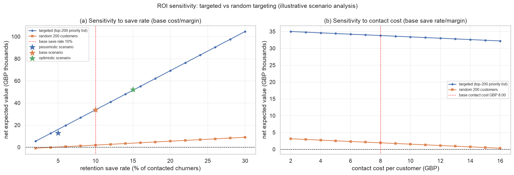</figure>


*Figure 13.* ROI sensitivity: net expected value across save rates and contact costs for the targeted top-200 campaign versus random targeting.

### 9.5 What the ROI number is not

The ROI is a **scenario**, not a forecast. It assumes the response rate is caused by the intervention; without a controlled experiment we cannot separate selection effects (we contact high-risk customers, who might have behaved differently anyway) from treatment effects. It uses segment-level expected value rather than individual lifetime value, ignores cannibalisation and offer-cost variation, and assumes out-of-time model performance transfers to the campaign period. Every assumption is stated in Table 20 so no reader mistakes the calculation for a measured return. The correct claim: the conservative validated figure is the defensible planning number, the 0.669-precision figure is an optimistic bound, and the next step is a randomised A/B test to estimate the save rate.

---

## 10. Interpretation, Limitations, Ethics and Future Work

### 10.1 What the results support

The evidence supports four careful claims. (i) The customer base is *segmentable*: a small number of behavioural groups explains a large share of revenue variation, and the solution is stable under resampling. (ii) Churn is *predictable at cohort level*: the models rank future churners well enough that the top decile contains far more churners than a random decile. (iii) Some co-purchase relationships are *stable across periods*, not only within the mining window. (iv) Combining these signals produces a *capacity-bounded, auditable action list*. None of these claims requires a causal interpretation, and none should be read as one.

### 10.2 Limitations

- **Anonymous-customer bias.** Identified customers cover only part of the revenue (13.572% of gross revenue is anonymous), and the excluded population may differ systematically. All customer-level rates describe identified customers only.
- **Label-window and seasonality effects.** The 90-day label is a business proxy, not observed attrition. T1 and T2 cover different seasons and therefore different base rates; T2's label window precedes the Christmas peak, so its churn rate is period-specific. A snapshot placed later than August 2011 would have a truncated label window before the data ends.
- **Single retailer, single market, one year.** Churn rates, rules and segment names do not transfer without refitting; the method transfers, the numbers do not.
- **No campaign or response data.** We predict inactivity, not treatment effect. The ROI is a churn-conditional scenario analysis: the conservative headline uses the realised churn rate of the priority list, the model-precision version is an optimistic bound, random targeting is only marginally positive and negative in the pessimistic scenario, and no measured uplift exists without an A/B test.
- **Descriptive clustering and in-sample labels.** Segments are fitted on T2 and assigned in-sample; they describe the decision cohort rather than predict future segment membership.
- **Association-rule lift is inflated by product variants.** Many high-lift rules pair colour or size variants of the same item, so lift overstates incremental cross-sell for those pairs.
- **Proxy features and a dropped recency variable.** RFM-style features proxy value and engagement rather than true lifetime value; `recency_days` was dropped by RFE and is only partly recovered by `distinct_months` and `avg_gap_days`.
- **Similarity and rule generalisation.** Rules depend on support thresholds and product mix; similarity suffers from sparsity and popularity bias. Both are descriptive, not causal.

### 10.3 Ethical and privacy considerations

The data contains no names, addresses or payment details, and `CustomerID` is a retailer-internal pseudonymous identifier. Even so, customer-level predictions are personal data in spirit: reporting is at segment and matrix level, small cells are not described individually, the priority list is an internal campaign tool, and no re-identification is attempted. The analysis uses no protected attributes, but country and purchasing behaviour can act as proxies, so campaigns should be reviewed for discriminatory targeting and customers should retain a clear opt-out. Where the retailer serves EU customers, GDPR principles of purpose limitation and data minimisation apply; in Hong Kong, the Personal Data (Privacy) Ordinance governs personal data. A production deployment would need a lawful basis, retention limits and human review before any contact.

### 10.4 What we would do with more data

(i) **Longer history and survival analysis** would model time-to-churn with censoring instead of a fixed 90-day label, giving a warning lead time. (ii) **Campaign data and uplift modelling** would replace the assumed response rate with an estimated incremental effect, turning the ROI scenario into a forecast. (iii) **Richer features** — product hierarchy, promotions, delivery experience, service contacts — would separate "left because of price" from "left because of a bad experience". (iv) **Graph or embedding representations** of customer–product interactions would improve cold-start similarity. With a longer horizon we would monitor drift, retrain on a rolling window, and test the priority list in a randomised holdout.

---

## 11. Contribution Statement

Five members delivered the project with clearly separated ownership. Table 21 maps each member to rubric items, code and report areas, and slides. The fuller statement, including commit areas and the requirement of meaningful commits and a personal agent trajectory, is in `CONTRIBUTIONS.md`.

**Table 21.** Individual contributions and rubric ownership. Replace Member A–E with names and student IDs in the final PDF.

| Member | Primary role | Rubric items owned (22% rubric) | Code and artifact areas | Report sections | Slides |
|---|---|---|---|---|---|
| Member A | Data and quality lead | Collect/load data, handle missing and noisy data (LO5); visualisation | Data audit, cleaning funnel, snapshots; `t02_data_quality_issues`, `t03_cleaning_decisions`, `f01_data_quality_overview` | §2, Appendix A | 4–5 |
| Member B | Feature engineering and segmentation lead | Feature selection (LO5); feature transformation (LO5); visualisation | 16 features, selection funnel, K-means; `t04_feature_dictionary`, `t05_feature_selection`, `t06_cluster_metrics`, `t07_segment_profiles`, `f02`–`f08` | §4–§5 | 6–7 |
| Member C | Churn modelling and evaluation lead | Learn models (LO4); evaluate performance (LO6) | Three classifiers, CV, held-out and out-of-time evaluation, thresholds, lift; `t08_model_metrics`, `t09_lift_deciles`, `f07`–`f09` | §6 | 8 |
| Member D | Association rules and similarity lead | Apply different data-mining techniques (LO3) | FP-Growth and holdout validation, metric comparison, lookalikes, similar products; `t03_distance_metrics`, `t04_lookalikes`, `t05_similar_products`, `t09_top_rules`, `t10_association_rules`, `f10`, `f11` | §7–§8 | 9–10 |
| Member E | Integration, decision framework and repository lead | Problem definition; solution design; interpretation (LO7); deliver models; presentation and repository compliance | Segment × risk matrix, priority list, ROI, README, agent-log templates; `t12`, `t13`, `t11`, `t15`, `f12`, `f13` | §1, §3, §9–§10, §13 | 1–3, 11–14 |

Each member also writes and verifies their own sections, commits to their own files or branch so the GitHub history reflects the workload, and maintains a personal trajectory under `agent-logs/` (§12). Workload is assessed from commits and trajectories, and ownership is structured so every member has substantive, visible work in both.

---

## 12. Agent Usage and Verification

### 12.1 How the project was built

AI agents were accelerators, not authors. Every interaction followed the workflow recommended in the course and documented in our logs: **human defines the problem → agent proposes a plan → human reviews the plan → agent implements or analyses → human verifies the output → revise and repeat**. The gate that matters is the fourth arrow: no agent output entered the report, notebook or slides without a named human review.

| Activity | Human-led | Agent-assisted | Human verification |
|---|---|---|---|
| Problem framing, method choice | All members | Drafting alternatives | Team review against the rubric |
| Data audit and cleaning rules | Member A | Profiling code, candidate rules | Rule-by-rule review; counts re-derived |
| Feature definitions and transforms | Member B | Implementation, plots, checks | Distribution and leakage assertions inspected |
| Model training and evaluation | Member C | Scaffolding, CV harness, plots | Independent re-run; metrics recomputed |
| Rules and similarity | Member D | Mining, holdout and neighbour code | Holdout numbers cross-checked against the rule table |
| Decision layer and ROI | Member E | Scenario table and sensitivity code | Assumption audit; arithmetic checked independently |
| Writing and editing | All members | Drafting and consistency checks | Every number checked against `metrics.json` |

### 12.2 How agent outputs were verified

Six checks were applied, with evidence in the per-member trajectories:

1. **Independent re-execution.** The notebook is run from a fresh kernel (`Restart & Run All`, or `jupyter nbconvert --execute`) and its outputs compared with committed figures and tables. A result that reproduces only in the agent's session is not accepted.
2. **Independent recomputation.** For each headline number, a member recomputed the quantity with a short, separately written check — for example, recomputing a churn rate from the cleaned line items for one snapshot, or the row count after cleaning — and compared it with the pipeline value.
3. **Code review of agent diffs.** Every agent-authored diff is read before merge, checking for hard-coded numbers, silent exception handling, accidental use of future transactions, and transforms fitted on full data.
4. **Cross-artifact consistency.** Figures are checked against the tables they illustrate (axes, category order, counts) and tables against `metrics.json`; a discrepancy means a defect, not a rounding difference.
5. **Adversarial review.** Each member prompted an agent to attack the evaluation ("how could this lift be optimistic?"), and the objections were fixed or written into the limitations — the product-variant caveat on rule lift is one result of this review.
6. **Reproducibility check.** Seeds are fixed, splits deterministic, environment pinned in `requirements.txt`; a second machine reproduces the same metrics.

### 12.3 Kept and rejected outputs

The logs record rejected proposals, because that is what demonstrates human judgement. Typical rejections included over-engineered models the data could not support, metrics that would have overstated performance (accuracy on an imbalanced label; lift computed on the test set rather than held out), and cleaning rules that silently dropped most of the data without reporting it. Agent-generated text was edited for accuracy; agent-generated code was retained only after review and a successful re-run. `agent-logs/` contains a README explaining the evidence standard, a per-person template and a filled example; each member keeps `agent-logs/MemberX_agent-trajectory.md`.

---

## 13. Reproducibility

The project runs on Python 3 with the libraries in `requirements.txt` (pandas, numpy, scipy, scikit-learn, mlxtend, matplotlib, seaborn, openpyxl and Jupyter). A single global seed (42) controls train/validation/test splits, cross-validation folds, K-means initialisation, bootstrap resamples and tree ensembles; the notebook sets `numpy` and `random` seeds at start-up and records library versions. The data file is not modified: `data/Online_Retail.xlsx` is the raw UCI download and all cleaning is code. The executed notebook runs in 27.5 seconds on the development machine, well inside the ten-minute target.

To reproduce: (1) run `python data/download_data.py` or download the UCI Online Retail `.xlsx` to `data/Online_Retail.xlsx`; (2) `pip install -r requirements.txt`; (3) `jupyter nbconvert --to notebook --execute --inplace notebooks/CDS3004_Project.ipynb` (equivalent to Restart & Run All); (4) the run regenerates every figure and table in `results/` plus `results/metrics.json`, `results/metrics_extra.json`, `results/metrics_summary.md` and `results/ARTIFACTS.md`. In Google Colab the notebook installs `mlxtend` automatically if it is missing.

```text
cds3004-project/
├── README.md, CONTRIBUTIONS.md
├── data/{Online_Retail.xlsx, README.md, download_data.py}
├── notebooks/CDS3004_Project.ipynb      # sections S0-S9, executed in place
├── code/{make_notebook.py, pipeline_notes.md}
├── results/{figures/, tables/, metrics.json, metrics_extra.json, metrics_summary.md, ARTIFACTS.md}
├── report/REPORT.md
├── slides/SLIDES.md
├── submission/SUBMISSION-CHECKLIST.md
└── agent-logs/
```

Results are deterministic given the seed and library versions, with two exceptions: floating-point differences can move a metric in the last decimal place across operating systems, and tree-ensemble results can differ slightly across scikit-learn versions. The committed `metrics.json` is the reference for every number reported here.

---

## References

Breiman, L. (2001). Random forests. *Machine Learning*, 45(1), 5–32.

Chen, D., Sain, S. L., & Guo, K. (2012). Data mining for the online retail industry: A case study of RFM model-based customer segmentation using data mining. *Journal of Database Marketing & Customer Strategy Management*, 19(3), 197–208.

Han, J., Kamber, M., & Pei, J. (2011). *Data Mining: Concepts and Techniques* (3rd ed.). Morgan Kaufmann.

Hubert, L., & Arabie, P. (1985). Comparing partitions. *Journal of Classification*, 2(1), 193–218.

Rousseeuw, P. J. (1987). Silhouettes: A graphical aid to the interpretation and validation of cluster analysis. *Journal of Computational and Applied Mathematics*, 20, 53–65.

UCI Machine Learning Repository. *Online Retail Data Set*. https://archive.ics.uci.edu/dataset/352/online+retail

---

## Appendix A. Rubric Coverage

The 22% project rubric has eleven items worth roughly 2% each; the presentation rubric (8%) is mapped slide-by-slide in `slides/SLIDES.md`.

| # | Rubric item (22%) | Where addressed | Artifact / evidence |
|---|---|---|---|
| 1 | Problem definition: clear problem, constraints, alternative solutions | §1.1–§1.3; Table 1 | Business question, four framings, success criteria |
| 2 | Solution design: related to problem, explained approaches, innovative integration | §3.1–§3.3; Tables 5–6 | Ten-section pipeline S0–S9, integration rationale, method-fit table |
| 3 | Collect/load datasets, feature characteristics, handle missing and noisy data (LO5) | §2.1–§2.5; Tables 2–4; Figure 1 | Schema, audit, sequential cleaning funnel, bias caveat |
| 4 | Apply data-mining techniques to select relevant features (LO5) | §4.4; Table 9; Figure 3 | Correlation filter, mutual information, RFE, validation PR-AUC, permutation importance |
| 5 | Advanced feature transformations (LO5) | §4.2–§4.3; Table 8; Figure 2 | Feature families, log1p, scaling, momentum and return features, leakage control |
| 6 | Data visualisation (LO5) | §5.3–§5.4, §6.3–§6.6, §7.2, §8.1, §9.1; Figures 1–13 | Diagnostics, profiles, ROC/lift, rules, similarity, matrix, sensitivity |
| 7 | Apply different data-mining techniques for various data (LO3) | §5–§9 | Clustering, classification, association rules, similarity, decision layer |
| 8 | Use data-mining techniques to learn models from data (LO4) | §5.1, §6.2, §7.1 | K-means, three classifiers, FP-Growth setups |
| 9 | Evaluate model performance with cross-validation, nested validation and separations (LO6) | §4.5, §6.1–§6.5; Tables 12–13; Figures 7–9 | 5-fold CV, 70/15/15 split, held-out T1, out-of-time T2, thresholds, lift |
| 10 | Interpret results correctly and critically (LO7) | §5.5, §6.6, §7.3, §9.5, §10.1–§10.2 | Interpretation, error analysis, product-variant and recency caveats, limitations |
| 11 | Deliver learnt models for decision making, with sound decisions (LO7) | §9.1–§9.5; Tables 17–20; Figures 12–13 | Segment × risk matrix, priority list, ROI assumptions and sensitivity |

## Appendix B. Artifact Inventory

All artifacts are regenerated by the notebook; `results/ARTIFACTS.md` is the authoritative file index. The figures and tables below are the ones embedded in the text; the remaining files are supporting evidence.

| Artifact | File | Used in |
|---|---|---|
| Table 2 | `t01_dataset_schema` | §2.1 |
| Table 3 | `t02_data_quality_issues` | §2.3 |
| Table 4 | `t03_cleaning_decisions` | §2.4 |
| Table 7 | `t02_cohort_summary` | §4.1 |
| Table 8 | `t04_feature_dictionary` | §4.2 |
| Table 9 | `t05_feature_selection` | §4.4 |
| Table 10 | `t06_cluster_metrics` | §5.2 |
| Table 11 | `t07_segment_profiles` | §5.3 |
| Table 12 | `t08_model_metrics` | §6.3–§6.4 |
| Table 13 | `t09_lift_deciles` | §6.5 |
| Table 14 | `t09_top_rules` | §7.2 |
| Table 15 | `t10b_business_rules` | §7.2–§7.3 |
| Table 16 | `t03_distance_metrics` | §8.1 |
| Table 17 | `t12_segment_risk_matrix` | §9.1 |
| Table 18 | `t13_action_table` | §9.1 |
| Table 19 | `t11_top200_targets` | §9.3 |
| Table 20 | `t14_roi_assumptions` | §9.4 |
| Figure 1 | `f01_data_quality_overview` | §2.3 |
| Figure 2 | `f02_feature_distributions` | §4.3 |
| Figure 3 | `f08_feature_importance` | §4.4, §6.6 |
| Figure 4 | `f04_elbow_silhouette` | §5.2 |
| Figure 5 | `f05_segment_profiles` | §5.3 |
| Figure 6 | `f06_cluster_pca` | §5.4 |
| Figure 7 | `f07_cv_model_comparison` | §6.3 |
| Figure 8 | `f08_roc_test_oot` | §6.4 |
| Figure 9 | `f09_lift_curve` | §6.5 |
| Figure 10 | `f10_association_rules` | §7.2 |
| Figure 11 | `f11_similarity_lookalikes` | §8.1 |
| Figure 12 | `f12_segment_risk_matrix` | §9.1 |
| Figure 13 | `f13_roi_sensitivity` | §9.4 |
| Supporting only | `f02_correlation_heatmap`, `f07_pr_and_lift_curve`, `f09_confusion_and_threshold`, `t05b_feature_evidence`, `t04_lookalikes`, `t05_similar_products`, `t10_association_rules`, `t10_decision_table`, `t15_priority_list_summary`, `t16_targeting_comparison`, `s06_permutation_importance`, `s06_threshold_analysis` | §4.4, §6.5–§6.6, §7.2, §8.2–§8.3, §9.4 |

Several alias files also exist for convenience, but the report and slides use only the canonical names above.
